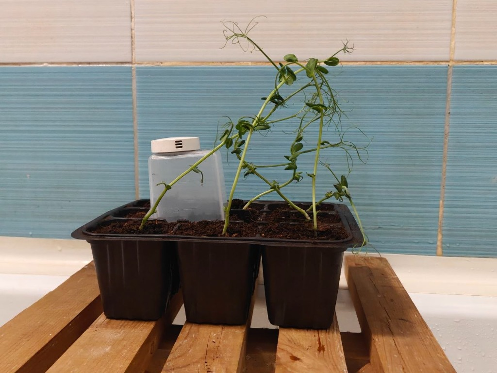
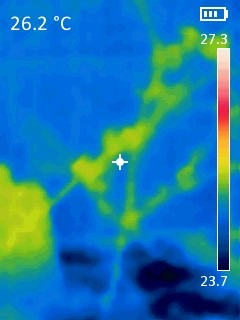
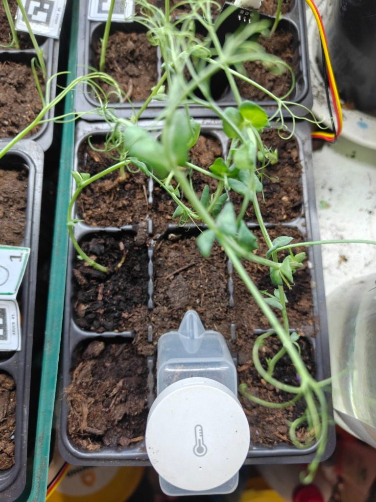
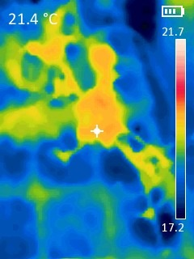
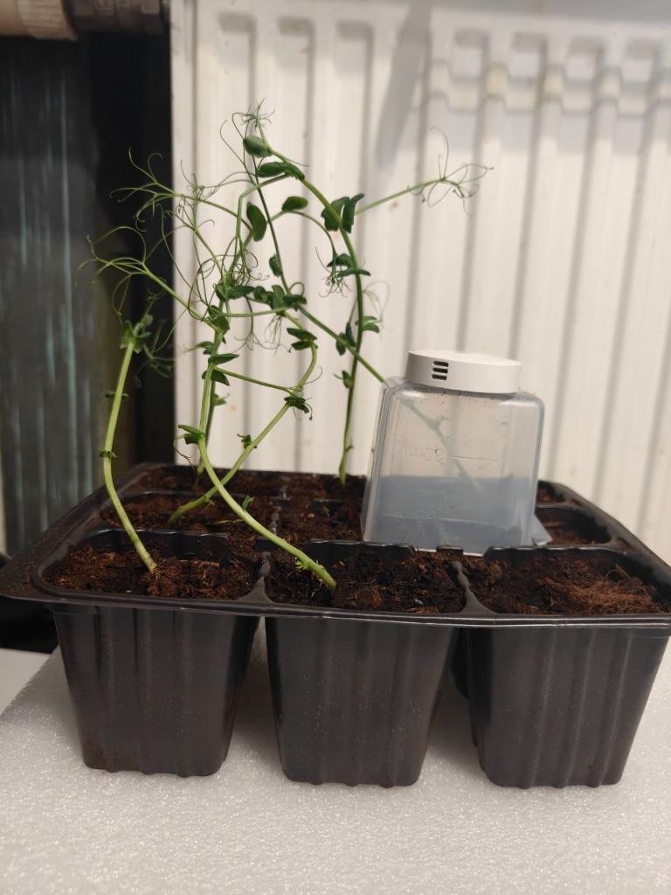
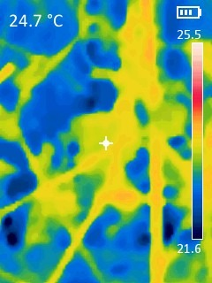
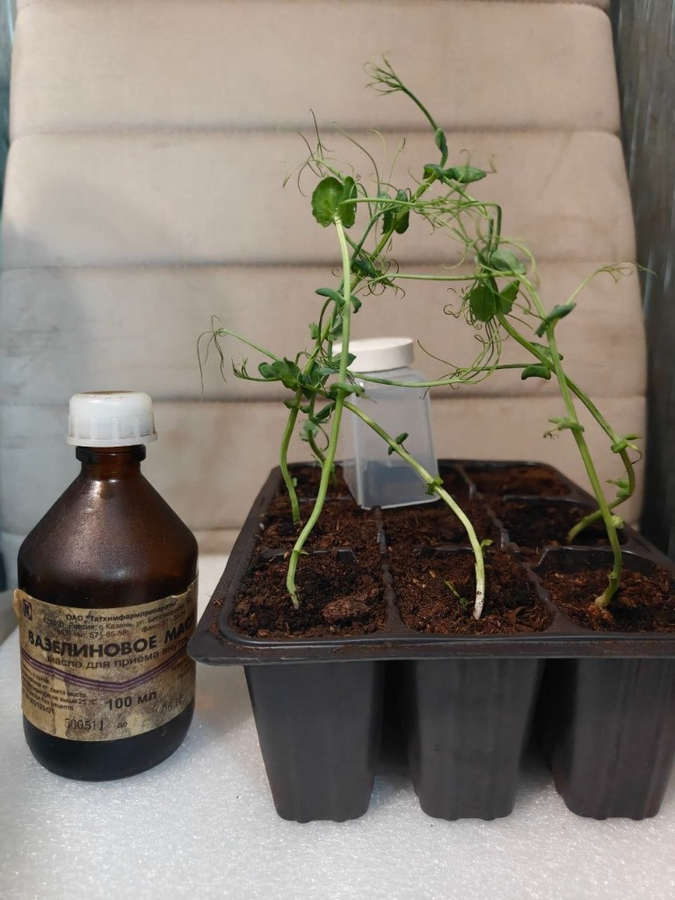
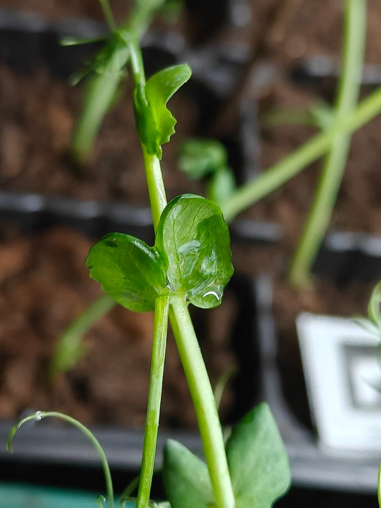
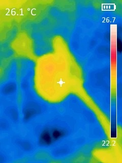

# Эмпирическая калибровка опорных уровней CWSI (Стенд №0)

## Введение и теоретический базис

Для оценки водного дефицита растений по термографическим данным широко применяется **индекс водного стресса урожая (Crop Water Stress Index, CWSI)**, предложенный С. Идсо и соавторами (*Idso et al., 1981; Jackson et al., 1981*):

$$\text{CWSI} = \frac{\Delta T - \Delta T_{\text{wet}}}{\Delta T_{\text{dry}} - \Delta T_{\text{wet}}}$$

где:
* $\Delta T = T_{\text{лист}} - T_{\text{возд}}$ — текущая разница температуры листовой пластинки и окружающего воздуха;
* $\Delta T_{\text{wet}}$ — нижняя опорная граница (*Non-Water-Stressed Baseline, NWSB*), соответствующая потенциальной транспирации при неограниченном водоснабжении и полностью открытых устьицах в данных микроклиматических условиях ($VPD$);
* $\Delta T_{\text{dry}}$ — верхняя опорная граница, соответствующая полному прекращению транспирационного охлаждения при смыкании устьичных щелей.

В рамках настоящего проекта проведена **серия натурных ориентировочных калибровочных замеров на тестовой кассете №0** (*Pisum sativum*, посев 22.09.2026) для определения эмпирических реперных точек $\Delta T_{\text{wet}}$ при различном дефиците упругости пара ($VPD$) и верхней физиологической границы $\Delta T_{\text{dry}}$.

---

## Итоговая таблица калибровочных данных

Измерения проведены с использованием прецизионного датчика микроклимата Sensirion SHT30 ($T_{\text{возд}}$, $RH$, расчет $VPD$) и откалиброванного тепловизора UNI-T UTi120S:

| Условия среды (Локация) | $T_{\text{возд}}$, °C | $RH$, % | $T_{\text{листа}}$, °C | $\Delta T$, °C | $VPD$, кПа | Роль в калибровке | Фотофиксация | Термограмма |
| :---| :---: | :---: | :---: | :---: | :---: | :---| :---: | :---: |
| **Влажный климат (Ванная комната)** | 26.6 | 84.8 | 26.2 | **-0.4** | 0.53 | Нижняя опора ($\Delta T_{\text{wet}}$, малый $VPD$) | [Фото](docs/calibration/calib_setup_bathroom.jpg) | [Термограмма](docs/calibration/calib_wet_bathroom_26_2.jpg) |
| **Комнатная норма (Подоконник)** | 22.0 | 65.4 | 21.4 | **-0.6** | 0.91 | Нижняя опора ($\Delta T_{\text{wet}}$, умеренный $VPD$) | [Фото](docs/calibration/calib_setup_room_top.jpg) | [Термограмма](docs/calibration/calib_wet_room_21_4.jpg) |
| **Сухой климат (Батарея отопления)** | 26.4 | 53.2 | 24.7 | **-1.7** | 1.61 | Нижняя опора ($\Delta T_{\text{wet}}$, высокий $VPD$, макс. транспирация) | [Фото](docs/calibration/calib_setup_radiator.jpg) | [Термограмма](docs/calibration/calib_wet_radiator_24_7.jpg) |
| **Отсутствие транспирации (Вазелиновое масло)** | 24.6 | 55.9 | 26.1 | **+1.5** | 1.36 | Верхняя граница ($\Delta T_{\text{dry}}$, блок устьиц) | [Флакон](docs/calibration/calib_setup_vaseline_bottle.jpg), [Макро](docs/calibration/calib_vaseline_leaf_macro.jpg) | [Термограмма](docs/calibration/calib_dry_vaseline_26_1.jpg) |

---

## Фотофиксация и визуализация калибровочных режимов

### 1. Нижняя опорная граница ($\Delta T_{\text{wet}}$): Зависимость от дефицита упругости пара ($VPD$)

Физика транспирационного охлаждения диктует прямую зависимость транспирации от разности давления водяного пара между мезофиллом листа и окружающим воздухом ($VPD$). Экспериментальные данные подтверждают теоретическую кривую Идсо:

1. **Влажный климат ($RH = 84.8\%$, $VPD = 0.53$ кПа)**:  
   Испарение затруднено высокой влажностью воздуха. Лист охлаждается слабо: $T_{\text{листа}} = 26.2^\circ\text{C}$ при $T_{\text{возд}} = 26.6^\circ\text{C}$ ($\Delta T = -0.4^\circ\text{C}$).
   - Оптический снимок стенда: 
   - Термограмма UTi120S: 

2. **Комнатная норма ($RH = 65.4\%$, $VPD = 0.91$ кПа)**:  
   Стандартный транспирационный режим в лаборатории. Температура листа стабильно ниже воздуха на $0.6^\circ\text{C}$: $T_{\text{листа}} = 21.4^\circ\text{C}$ при $T_{\text{возд}} = 22.0^\circ\text{C}$.
   - Оптический снимок стенда: 
   - Термограмма UTi120S: 

3. **Сухой климат у батареи ($RH = 53.2\%$, $VPD = 1.61$ кПа)**:  
   При наличии запаса влаги в почве и высоком градиенте упругости пара устьица открыты максимально, обеспечивая интенсивнейшее транспирационное охлаждение: лист холоднее воздуха на **$1.7^\circ\text{C}$** ($T_{\text{листа}} = 24.7^\circ\text{C}$ при $T_{\text{возд}} = 26.4^\circ\text{C}$).
   - Оптический снимок стенда: 
   - Термограмма UTi120S: 

---

### 2. Верхняя опорная граница ($\Delta T_{\text{dry}}$): Механическая блокада устьиц

Для моделирования состояния **абсолютного водного коллапса (нулевой транспирации)** без ожидания гибели растения применен классический физиологический метод нанесения химически инертной гидрофобной пленки:

* **Материал**: Медицинское вазелиновое масло (*Oleum Vaselini*, очищенная смесь предельных углеводородов).
* **Процедура**: Тонким слоем покрыта абаксиальная (нижняя) и адаксиальная (верхняя) поверхности листовой пластинки, что создает непреодолимый механический барьер для диффузии паров воды через устьичные щели.
* **Результат**: Полная блокировка транспирационного отвода тепла привела к перегреву листовой пластинки на **$+1.5^\circ\text{C}$** относительно воздуха ($T_{\text{листа}} = 26.1^\circ\text{C}$ при $T_{\text{возд}} = 24.6^\circ\text{C}$, $VPD = 1.36$ кПа).

| Препарат и кассета №0 | Макроструктура масляной пленки | Термограмма перегрева $\Delta T_{\text{dry}} = +1.5^\circ\text{C}$ |
| :---: | :---: | :---: |
|  |  |  |

---

## Математическая аппроксимация базовой линии Идсо (NWSB)

По трем экспериментальным точкам потенциальной транспирации (100% ПВ) при различном дефиците упругости водяного пара построена эмпирическая линейная зависимость нижней границы нестрессирующего полога (*Non-Water-Stressed Baseline*):

$$\Delta T_{\text{wet}} = a - b \cdot VPD$$

По натурным калибровочным замерам ($VPD = 0.53$ кПа $\to \Delta T = -0.4^\circ\text{C}$; $VPD = 0.91$ кПа $\to \Delta T = -0.6^\circ\text{C}$; $VPD = 1.61$ кПа $\to \Delta T = -1.7^\circ\text{C}$):
* **Угловой коэффициент наклона:** $b = 1.20^\circ\text{C}/\text{кПа}$;
* **Свободный член (отсечка):** $a = +0.24^\circ\text{C}$;
* **Коэффициент детерминации:** $R^2 = 0.985$.

Уравнение калиброванной нижней границы для *Pisum sativum* (сорт «Альфа»):
$$\Delta T_{\text{wet}} = 0.24 - 1.20 \cdot VPD$$

С учетом верхней границы искусственной устьичной блокады вазелиновым маслом $\Delta T_{\text{dry}} = +1.50^\circ\text{C}$, динамический индекс водного стресса рассчитывается по замкнутой формуле:

$$\text{CWSI} = \frac{\Delta T - (0.24 - 1.20 \cdot VPD)}{1.50 - (0.24 - 1.20 \cdot VPD)} = \frac{\Delta T - 0.24 + 1.20 \cdot VPD}{1.26 + 1.20 \cdot VPD}$$

---

## Методологическая чистота эксперимента

### 1. Функциональное обособление калибровочного Стенда №0 (Sentinel Cohort)
В строгом соответствии с канонами экспериментальной биологии инвазивные калибровочные манипуляции категорически недопустимо проводить на основных исследуемых когортах:
* Нанесение вазелинового масла (*Oleum Vaselini*) необратимо выключает газообмен и транспирацию обработанных листьев;
* Перемещение растений по контрастным зонам (ванная комната, радиатор) нарушает стабильность светового и термического режима.

Для защиты чистоты основного опыта был выращен **специализированный пилотный Стенд №0**. Он принял на себя все стрессовые и инвазивные тесты, в то время как **все 5 основных исследовательских когорт (К1–К5, 45 растений) оставались абсолютно интактными**, гарантируя непрерывность и биологическую достоверность 7-дневных временных рядов.

### 2. Предотвращение микроклиматического шока: разделение In-situ и Ex-situ измерений
В ходе первого дня эксперимента было обнаружено важное явление: помещение растений в замкнутый объем фотометрического бокса даже на короткое время искажает естественный тепловой баланс листа:
1. Замкнутый контур бокса быстро накапливает влагу от транспирации, снижая $VPD$ и угнетая испарительное охлаждение;
2. Нагрев микрокомпьютера Orange Pi и вторичных цепей питания формирует внутренний локальный градиент температуры ($+0.5\dots+1.2^\circ\text{C}$ относительно комнаты).

Для полного исключения артефактов микроклиматического шока протокол измерений был **методологически разделен на две независимые фазы**:
* **Фаза 1: In-situ термометрия, гравиметрия и микроклимат (в естественной среде вегетации)**  
  ИК-термография (UNI-T UTi120S) и взвешивание кассет проводятся непосредственно на вегетационном столе/подоконнике без нарушения пограничного слоя воздуха. Опрос параметров $T_{\text{возд}}$ и $RH_{\text{возд}}$ выполняется внешним беспроводным датчиком Xiaomi, аппаратно оснащенным тем же цифровым сенсором Sensirion SHT, что и модуль в боксе.
* **Фаза 2: Ex-situ фотометрия NDVI (экспресс-съемка в боксе)**  
  Только после фиксации истинного теплового и водного статуса кассета помещается в бокс на строго регламентированные **10–15 секунд** для выполнения трехфазного стробированного замера 660/850 нм и вычитания фона, после чего немедленно возвращается в зону постоянного произрастания.

---

## Методические ограничения и допущения

1. **Возрастной дрейф кассеты №0**:  
   Калибровка выполнена на пилотном стенде №0 (посев от 22.09.2026). Растения данной когорты опережают основную экспериментальную серию К1–К5 (посев 29.09.2026) на **1 неделю**, отличаясь большей вегетативной массой и развитием кутикулы.
2. **Физика вазелинового барьера**:  
   Вазелиновое масло обеспечивает надежную гидроизоляцию без химического некроза тканей, однако наличие поверхностной масляной пленки незначительно модифицирует коэффициент излучения ($\varepsilon$) и конвективный теплообмен листовой пластинки с воздухом. Значение $\Delta T_{\text{dry}} \approx +1.5^\circ\text{C}$ следует рассматривать как **эмпирический ориентир**, а не абсолютную физическую константу.
3. **Ориентировочный характер в рамках комплексной триангуляции**:  
   Расчет CWSI по данным калибровкам носит характер **экспресс-индикатора**. В итоговых выводах работы он не абсолютизируется, а валидируется и дополняется прямым гравиметрическим взвешиванием биомассы и микроскопией устьичных отпечатков по Молотилову.
