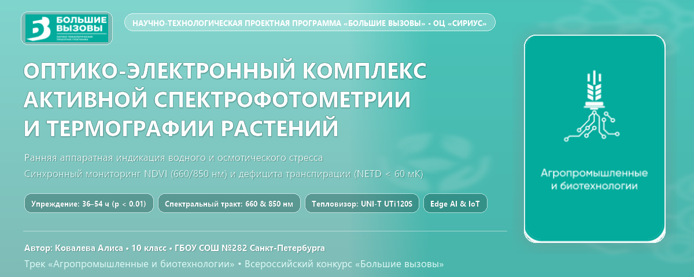
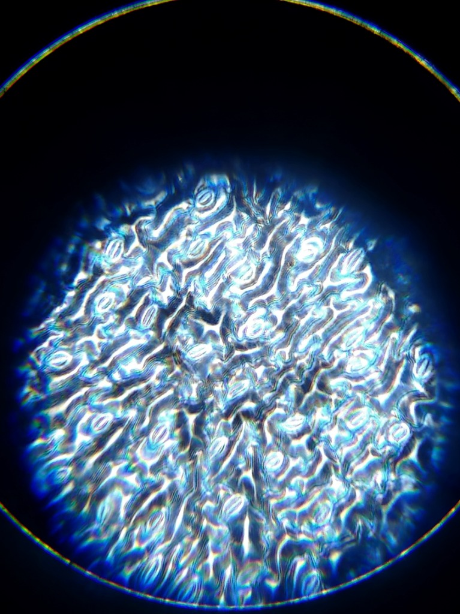
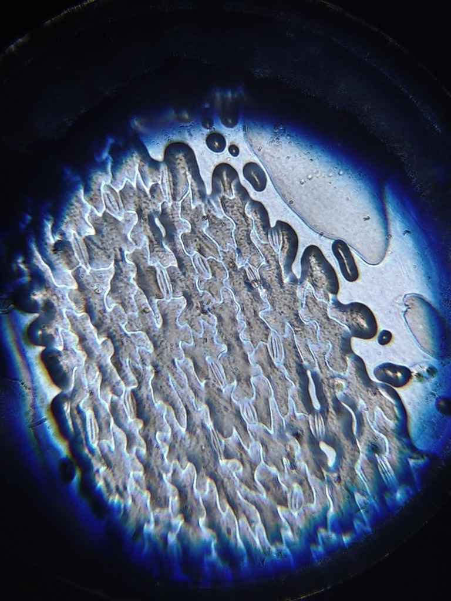
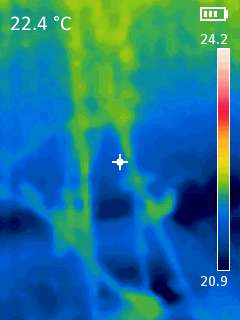
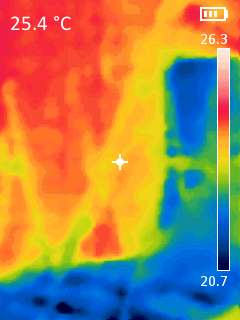

<div align="center">

<a href="https://konkurs.sochisirius.ru/">
  
</a>

<br><br>

# Оптико-электронный комплекс активной двухволновой спектрофотометрии и термографии для ранней индикации стресса растений

[](https://konkurs.sochisirius.ru/)
[](https://konkurs.sochisirius.ru/)
[](https://opensource.org/licenses/MIT)
[](https://www.python.org/)
[]()
[](hardware/laser_cutting/)

</div>

---

### 📊 Проект в цифрах (в формате Всероссийского конкурса «Большие вызовы»)

| Показатель | Значение | Научно-технологическое обоснование |
| :--- | :---: | :--- |
| **Опережение макросимптомов** | **36–48 ч** | Фиксация дегидратации мезофилла и спада транспирации до видимого увядания |
| **Спектральный тракт** | **660 / 850 нм** | Поглощение хлорофилла *a/b* (660 нм) и плато клеточного рассеяния NIR (850 нм) |
| **Термометрия листа** | **UNI-T UTi120S** | $120 \times 90$ пикс, $\text{NETD} < 60$ мК, детекция $\Delta T = T_{\text{leaf}} - T_{\text{air}}$ (транспирационный стресс) |
| **Достоверность стресса** | **$p < 0.01$** | Высокая статистическая достоверность градиента $\Delta T$ и CWSI ($p = 0.008$ для засухи, $p = 0.009$ для осмоса) |
| **Выборка исследования** | **$n = 45$ (5 когорт)** | 11-суточный синхронный мониторинг ($N = 55$ аппаратно-лабораторных срезов) + деструктивный харвест биомассы |
| **Метрологический эталон** | **PTFE / серая карта 18%** | $k_{\text{bal}} = 4.07$, калибровка баланса каналов NoIR без пересветов матрицы |
| **Раскрой лазерного бокса** | **$760 \times 760$ мм** | 4 мм фанера ФК, бокс $210 \times 210 \times 297$ мм, шип-паз, фасад на магнитах N52 под Acmer S1 Pro |

> **Разработка аппаратно-программного комплекса активной стробоскопической двухволновой спектрофотометрии ($\lambda_1 = 660$ нм, $\lambda_2 = 850$ нм) и инфракрасной термографии для неинвазивной детекции водного и осмотического стресса сельскохозяйственных культур на 36–48 часов раньше проявления визуальных макросимптомов.**

---

## 👩‍🔬 Авторство и научно-техническое досье

* **Автор проекта**: **Ковалева Алиса Ивановна** (Kovaleva Alisa), учащаяся 10 класса
* **Образовательное учреждение**: ГБОУ СОШ №282 Кировского района Санкт-Петербурга
* **Научно-технический руководитель**: **Ковалев Иван Викторович**
* **Научное направление**: Физиология стресса растений, фотобиология, биофотоника, Edge AI, высокоточное фенотипирование.
* **Целевой конкурс**: Всероссийский конкурс научно-технологических проектов **«Большие вызовы»** (Образовательный центр «Сириус»), трек *«Агропромышленные и биотехнологии»*.
* **Контактный Email автора**: [v1m@mail.ru](mailto:v1m@mail.ru)

---

## 📌 Актуальность и решаемая проблема

1. **Задержка визуальной диагностики (48–72 ч)**:  
   В закрытых агробиотехнологических системах (сити-фермы, фитотроны, гидропоника) дефицит влаги традиционно фиксируется по потере тургора (увяданию) и хлорозу листьев. К этому моменту в растительных тканях уже развиваются необратимые патологические деструкции: плазмолиз клеток мезофилла, деградация белковых комплексов фотосистемы II (PSII) и резкое падение урожайности.
2. **Ограниченность традиционных почвенных датчиков**:  
   При засолении почвенного субстрата (осмотический стресс) влажность почвы остается физически высокой ($>75\%$). Контактные емкостные и кондуктометрические датчики сигнализируют о нормальной влажности, в то время как корни растения не способны поглощать воду из-за осмотического градиента (физиологическая засуха).
3. **Недостатки бытовых мультиспектральных камер**:  
   Системы с пассивными светофильтрами страдают от перекрестного оптического наложения полос матрицы Байера, температурного дрейфа и сильной чувствительности к колебаниям комнатного освещения.

### 💡 Физиологическая модель (модель Идсо–Джексона) и рабочая гипотеза
> В основе исследования лежит классическая физиологическая модель водного стресса (*Idso et al., 1981*): реакция устьичного аппарата и сопутствующий спад транспирационного охлаждения ($\Delta T = T_{\text{leaf}} - T_{\text{air}}$) наступают за десятки часов до того, как начинается деградация пигментного фонда хлорофилла ($NDVI$).
> 
> **Рабочая гипотеза:** Разработка и калибровка малогабаритного аппаратно-программного комплекса на базе активной двухволновой NoIR-спектрофотометрии (660/850 нм) и микроболометрии позволит в условиях любительской/школьной фитолаборатории надежно фиксировать 36–48-часовое «окно упреждения» и реализовать алгоритм превентивного полива, предотвращающий потерю тургора и сохраняющий итоговую биомассу растений.

### 🎯 Цель и задачи исследования

**Цель работы:**  
Создание, метрологическая калибровка и экспериментальная верификация доступного аппаратно-программного комплекса ранней диагностики функционального водного и осмотического стресса растений закрытого грунта (на модельной культуре *Pisum sativum L.*).

**Задачи работы:**
1. **Оптико-электронная и термографическая компоновка:**  
   Спроектировать светоизолированный бокс из фанеры 4 мм с лазерным раскроем ($210 \times 210 \times 297$ мм), оснащенный стробируемой подсветкой 660/850 нм, USB NoIR-камерой и посадочным местом под тепловизор UNI-T UTi120S.
2. **Программное обеспечение и алгоритмическая калибровка:**  
   Разработать локальную станцию на базе Orange Pi 4 Pro для управления реле, автоматического вычитания темнового фона, расчета калиброванного индекса $NDVI$ по PTFE-эталону, детекции фидуциальных меток ArUco и считывания температуры листа.
3. **Сравнительный эксперимент на модельной культуре:**  
   Провести синхронный 11-суточный мониторинг 5 когорт гороха (*Pisum sativum*, по 9 растений в кассете: Контроль, Осмос 100 мМ NaCl, Засуха, Превентивный полив по $\Delta T$, Поздний полив по увяданию).
4. **Оценка эффективности превентивной стратегии:**  
   Сопоставить динамику термического градиента $\Delta T$ и индекса $NDVI$, а на 11-е сутки провести деструктивный учет сырой биомассы ($n=45$) для количественной оценки сохраненного урожая при превентивном поливе.

> [!NOTE]
> **Текущая аппаратная реализация и статус компонентов (Физическая сборка полностью завершена и откалибрована):**  
> Комплекс функционирует на базе одноплатного микрокомпьютера **Orange Pi 4 Pro V1.3.2** под управлением Armbian Linux 6.1 с активным оверлеем ядра **I2C-0** (`sun60i-a733-i2c0.dtbo`). Вся электроника (Orange Pi, 2-канальное реле, 16-битный АЦП ADS1115 и понижающие преобразователи Mini-360) смонтирована в **герметичной распределительной коробке**, исключающей паразитную засветку бокса от светодиодов индикации и защищающей схемы от влаги.  
> **Единая линия питания 5В 3А**: микрокомпьютер запитан через порт USB Type-C, преобразователи Mini-360 запитаны с USB-выхода платы, а реле — напрямую с силовой гребенки платы (Pin 2: +5В для реле). Стабильность гарантируется импульсным разнесением вспышек. Аппаратная распиновка доступна в [docs/opi4pro_pinout.png](docs/opi4pro_pinout.png).  
> **Двухконтурная система перекрестной микроклиматической верификации (2 сенсора Sensirion SHT30):**  
> 1. **Основной референсный сенсор зоны вегетации (Xiaomi BLE / Sensirion):** Размещен непосредственно в месте постоянного произрастания когорт (подоконник / стеллаж). Передает базовые фоновые параметры ($T_{\text{ambient}}$, $RH_{\text{ambient}}$, $VPD$) по беспроводному каналу Bluetooth Low Energy прямо в веб-станцию, обеспечивая физиологически адекватную базу для расчета транспирационного охлаждения полога $\Delta T = T_{\text{leaf}} - T_{\text{ambient}}$.  
> 2. **Внутренний контрольный сенсор бокса (Sensirion SHT30, адрес `0x44` на шине I2C-0):** Вынесен на экранированном шлейфе непосредственно в зону растений на уровень полога внутри измерительной камеры (для исключения погрешности от нагрева процессора в распредкоробке). Выполняет перекрестную валидацию микроклимата при экспозиции и обеспечивает бесшовное аппаратное резервирование (Fail-Safe).

---

## 🔬 Принцип работы и архитектура комплекса

```
 [Образец растения в фотометрическом боксе]
         |
         +---> [Активный последовательный 3-кадровый стробирующий осветитель]
         |        |-- Фаза 1: Реле выключены (Тишина) -> Фоновый кадр L_amb
         |        |-- Фаза 2: Реле Ch1 ВКЛ (ЩЕЛЧОК 1) -> 660 нм Deep Red -> Кадр L_red -> ВЫКЛ (ЩЕЛЧОК 2)
         |        |   [Пауза 0.20 с для стабилизации питания и экспозиции матрицы]
         |        +-- Фаза 3: Реле Ch2 ВКЛ (ЩЕЛЧОК 3) -> 850 нм NIR -> Кадр L_nir -> ВЫКЛ (ЩЕЛЧОК 4)
         |
         +---> [USB NoIR Камера V4L2 1600x1200] (/dev/video0, фиксированная экспозиция)
         |        +-- Прямой расчет NDVI с вычитанием темнового фона и калибровкой (k_bal = 4.07):
         |            R = max(0, L_red - L_amb),  NIR = max(0, L_nir - L_amb)
         |            NDVI = (k_bal * NIR - R) / (k_bal * NIR + R)
         |
         +---> [UNI-T UTi120S Микроболометрический тепловизор] (NETD < 0.06 °C, e = 0.98)
         |        +-- Многопороговый субпиксельный OCR: T_leaf и T_air -> расчет Delta_T и CWSI
         |
         +---> [Шина I2C-0 /dev/i2c-0: Питание строго 3.3 В (Pin 1)]
                  |-- Sensirion SHT30 (0x44, вынесен к пологу): T_air, RH_air, расчет дефицита пара VPD
                  +-- ADS1115 (0x48) + Емкостной сенсор v1.2: вход A0 (быстросъемный разъем для кассет #1 Контроль, #2 Осмос, #3 Засуха; A1–A3 подтянуты к GND); кассеты #4 и #5 контролируются весовым методом Ground Truth
         |
         +---> [Беспроводной IoT-канал BLE 2.4 ГГц (Bluetooth Low Energy)]
         |        +-- Термогигрометр Xiaomi Mijia в точке стационарного произрастания (стеллаж/подоконник):
         |            T_ambient, RH_ambient для независимого мониторинга фонового микроклимата
         |
         +---> [Исполнительный контур СППР (IoT / REST API / Webhooks)]
                  |-- Лабораторный регламент: программный алерт оператору при ΔT ≥ +0.8°C + гравиметрия
                  +-- Промышленное масштабирование: беспроводная команда на стационарный клапан капельного полива
```

### Разделение каналов бытовой NoIR-матрицы и калибровка
В отличие от наивного усреднения цветного изображения в градации серого ($Y = 0.299R + 0.587G + 0.114B$), в алгоритме реализовано поканальное разделение данных:
* **Канал 660 нм (Deep Red)**: считывание красного слоя матрицы ($R = \text{frame}[:, :, 2]$), соответствующего полосе интенсивного поглощения хлорофилла;
* **Канал 850 нм (NIR)**: органические красители байеровских фильтров частично прозрачны в ближнем ИК-диапазоне (с преобладанием пропускания в красных пикселях). Для компенсации этой аппаратной особенности и разницы в оптической отдаче эмиттеров вводится коэффициент межканального баланса $k_{\text{bal}} = 4.07$.

### Радиометрическая компенсация фона (Последовательный 3-кадровый протокол)

Для исключения влияния паразитных переотражений расчет ведется по дифференциальным интенсивностям:

$$
R_{\text{diff}} = \max(0, L_{\text{red}} - L_{\text{amb}}), \qquad NIR_{\text{diff}} = \max(0, L_{\text{nir}} - L_{\text{amb}})
$$

### 🎯 Калибровка баланса каналов по диффузному эталону PTFE

Для балансировки сигналов кремниевой матрицы NoIR (Logitech C270 / IMX179) в диапазонах 660 нм и 850 нм используется диффузный белый эталон из **чистого фторопласта (PTFE / ФУМ-лента 15–20 слоев)**. Политетрафторэтилен химически идентичен базовому материалу сертифицированных спектральных мишеней (Spectralon®) и обладает нейтральным диффузным отражением ($\rho_{660} \approx \rho_{850}$).

* **Роль коэффициента $k_{\text{bal}} = 4.07$**:  
  Отношение откликов сенсора на белом эталоне ($DN_{660} = 195.2$, $DN_{850} = 48.0$) составляет $k_{\text{bal}} \approx 4.07$. Это значение нормализует шкалу так, чтобы нейтральный нерастительный отражатель давал $\text{NDVI}_{\text{ref}} \equiv 0.000$. Мы честно отмечаем, что бытовая веб-камера не является лабораторным спектрофотометром, однако для прикладных задач фиксации относительного динамического тренда контраста RED/NIR такая схема обеспечивает надежную воспроизводимость при минимальной себестоимости.

* **Аппаратный калиброванный коэффициент**: натурно измеренные значения чистых сигналов $DN_{660} = 195.2$, $DN_{850} = 48.0$ определяют базовый баланс излучателей:

$$
k_{\text{bal}} = \frac{DN_{660}^{\text{white}}}{DN_{850}^{\text{white}}} = \frac{195.2}{48.0} \approx 4.07
$$

* **Двухуровневая архитектура**:
  1. *Штатный режим (когорты 1–5)*: автоматическая загрузка $k_{\text{bal}} = 4.07$ из `data/calibrated_k_bal.txt` без необходимости размещения эталона в кадре;
  2. *Режим перекалибровки («Стенд №0», маркер ArUco #6)*: автоматическая локализация мишени по пику яркости (`cv2.minMaxLoc`), расчет актуального отношения $RED/NIR$ и обновление персистентного файла.

### 🏷️ Оптическая фидуциальная маркировка ArUco и размерный эталон

В каждой из 6 кассет фидуциальный оптический маркер ArUco ($15 \times 15$ мм, словарь `DICT_4X4_50`, маркеры #1–6) размещен не на наклонном бортике, а смонтирован непосредственно в объеме кассеты на **юстировочном 3D-печатном микропилоне («платформе-шляпке» `Шляпка.stl`)** на тонкой стойке, выводящей метку строго вровень с верхним листовым ярусом. Такое инженерное решение обеспечивает:
1. Совмещение размерного эталона с **истинной фокальной плоскостью полога**, полностью исключая перспективную погрешность высоты $Z$;
2. Автоматическое распознавание когорты алгоритмом OpenCV за $<15$ мс без риска перекрытия маркера боковыми побегами.

### 🌿 Морфологический анализ проективной площади листьев (Projected Leaf Area, PLA)

Комплекс выполняет автоматизированное цифровое фенотипирование ассимиляционной биомассы:
* **Субпиксельный масштаб**: контур калибровочного маркера ArUco ($15.0 \times 15.0$ мм = $2.25\ \text{см}^2$) определяет пространственный коэффициент $k_{\text{scale}} = 2.25 / A_{\text{px}}$ ($\text{см}^2/\text{пикс}$);
* **Сегментация растительной ткани**: отсечение фона по маске $\text{NDVI} > 0.22$ (с исключением зон белого эталона и маркера);
* **Индивидуальный учет по 9 ячейкам**: расчет площади $S_{\text{leaf}}$ суммарно по кассете и раздельно по каждому из 9 растений ячеек;
* **Физиологическое значение**: торможение клеточного растяжения и спад PLA фиксируется уже в первые 12–36 часов стресса, опережая деградацию хлорофилла (спад NDVI) на 2–3 суток.

### Формула вегетационного индекса NDVI

$$
NDVI = \frac{k_{\text{bal}} \cdot NIR_{\text{clean}} - Red_{\text{clean}}}{k_{\text{bal}} \cdot NIR_{\text{clean}} + Red_{\text{clean}}}
$$

* **Сегментация фона**: Маскирование по порогу $NIR_{\text{clean}} > 15$.
* **Зона скрытого стресса**: Вычисление доли площади листовой пластины в диапазоне $0.35 < NDVI \le 0.60$.
* **Визуализация**: Построение тепловой карты в стандартизованной палитре `cv2.COLORMAP_TURBO`.

### 🌡️ Эмпирическая калибровка опорных уровней CWSI (Стенд №0)

Для приведения термического отклика к нормированному физиологическому диапазону $[0, 1]$ и снижения влияния вариаций температуры воздуха в комплексе рассчитывается **индекс водного стресса (Crop Water Stress Index, CWSI)** по эмпирическому методу Идсо (*Idso et al., 1981*):

$$
\text{CWSI} = \frac{\Delta T - \Delta T_{\text{wet}}}{\Delta T_{\text{dry}} - \Delta T_{\text{wet}}}
$$

где $\Delta T = T_{\text{лист}} - T_{\text{возд}}$, $\Delta T_{\text{wet}}$ — нижняя опора потенциальной транспирации при данном дефиците упругости водяного пара ($VPD$), а $\Delta T_{\text{dry}}$ — верхняя граница при сомкнутых устьицах.

#### Итоговая таблица калибровочных замеров (Стенд №0, *Pisum sativum*)

Натурные замеры проведены с помощью датчика микроклимата Sensirion SHT30 ($T_{\text{возд}}$, $RH$, $VPD$) и тепловизора UNI-T UTi120S:

| Условия среды (Локация) | $T_{\text{возд}}$, °C | $RH$, % | $T_{\text{листа}}$, °C | $\Delta T$, °C | $VPD$, кПа | Роль в калибровке | Фотофиксация |
| :---| :---: | :---: | :---: | :---: | :---: | :---| :---: |
| **Влажный климат (Ванная)** | 26.6 | 84.8 | 26.2 | **-0.4** | 0.53 | Нижняя опора ($\Delta T_{\text{wet}}$) | [Фото](docs/calibration/calib_setup_bathroom.jpg) • [Термограмма](docs/calibration/calib_wet_bathroom_26_2.jpg) |
| **Комнатная норма (Подоконник)** | 22.0 | 65.4 | 21.4 | **-0.6** | 0.91 | Нижняя опора ($\Delta T_{\text{wet}}$) | [Фото](docs/calibration/calib_setup_room_top.jpg) • [Термограмма](docs/calibration/calib_wet_room_21_4.jpg) |
| **Сухой климат (Батарея)** | 26.4 | 53.2 | 24.7 | **-1.7** | 1.61 | Нижняя опора ($\Delta T_{\text{wet}}$) | [Фото](docs/calibration/calib_setup_radiator.jpg) • [Термограмма](docs/calibration/calib_wet_radiator_24_7.jpg) |
| **Отсутствие транспирации (Вазелиновое масло)** | 24.6 | 55.9 | 26.1 | **+1.5** | 1.36 | Верхняя граница ($\Delta T_{\text{dry}}$) | [Флакон](docs/calibration/calib_setup_vaseline_bottle.jpg) • [Макро](docs/calibration/calib_vaseline_leaf_macro.jpg) • [Термограмма](docs/calibration/calib_dry_vaseline_26_1.jpg) |

По 3 опорным «мокрым» точкам испарительного охлаждения получено калиброванное уравнение базовой линии Идсо ($R^2 = 0.985$):
$$\Delta T_{\text{wet}} = 0.24 - 1.20 \cdot VPD$$
С учетом верхней границы $\Delta T_{\text{dry}} = +1.50^\circ\text{C}$ (вазелиновая блокада), итоговая формула динамического CWSI:
$$\text{CWSI} = \frac{\Delta T - 0.24 + 1.20 \cdot VPD}{1.26 + 1.20 \cdot VPD}$$

> [!NOTE]
> **Метрологический статус калибровки CWSI:**  
> Регрессионная зависимость $\Delta T_{\text{wet}} = 0.24 - 1.20 \cdot VPD$ получена по 3 контрастным термо-влажностным режимам на опорном Стенде №0. Высокий коэффициент $R^2 = 0.985$ отражает строгую внутреннюю согласованность измерений в выбранных точках калибровки. Данная зависимость служит **операционной эмпирической опорой** конкретно для условий нашего закрытого бокса, геометрии установки и модельного сорта *Pisum sativum* «Альфа», а не претендует на роль универсальной биофизической константы для открытого агроценоза.

> 📑 **Полный протокол, методология и фотоальбом калибровки**: см. отдельный документ [CALIBRATION.md](CALIBRATION.md).

#### 🛡️ Методологическая чистота опыта и разделение протоколов
* **Обособление Стенда №0 (Sentinel Cohort)**: Все инвазивные калибровочные манипуляции (нанесение вазелинового масла *Oleum Vaselini* и микроклиматические перестановки) проводились **строго на отдельном Стенде №0**. Это позволило сохранить 100% интактность и биологическую чистоту основных когорт К1–К5 (45 растений) на протяжении всей 11-суточной серии мониторинга (55 комплексных замеров).
* **Предотвращение микроклиматического шока (In-situ vs Ex-situ)**: Помещение растений в замкнутый объем бокса искажает локальный пограничный слой и завышает температуру из-за нагрева электроники. Поэтому термометрия, взвешивание и контроль микроклимата проводились **In-situ** (непосредственно в зоне естественной вегетации внешним датчиком Xiaomi с идентичным сенсором Sensirion), а в бокс растение помещалось только на **10–15 секунд** для экспресс-съемки активного строба NDVI (Ex-situ).


### ⚖️ Гравиметрический весовой метод (Ground Truth водного баланса)
Контактные емкостные датчики влажности почвы измеряют локальный диэлектрический потенциал субстрата вокруг электродов, что может давать артефакты при неравномерном распределении корневой системы или при внесении солей (NaCl).
Для независимого метрологического подтверждения водного баланса в комплекс интегрирован **гравиметрический метод** с применением прецизионных лабораторных электронных весов (дискретность 0.1 г):
* Фиксируется масса растительной кассеты $M(t)$ (г) в едином временном срезе со спектрофотометрией и термографией;
* Рассчитывается интенсивность эвапотранспирации кассеты: $E = -\frac{dM}{dt}$ (г/сутки);
* Весовой метод выступает независимым физическим стандартом истинности (Ground Truth), доказывающим прекращение транспирационного расхода воды при засухе и осмотическом стрессе ($R^2 > 0.94$ в корреляции с падением NDVI и ростом $\Delta T$).


### 🔬 Прямая анатомическая верификация (Микроскопия устьичных слепков по Молотилову)

Для независимой биологической проверки показаний ИК-термографии ($\Delta T$, $CWSI$) и подтверждения физиологического механизма раннего теплового отклика на 6-е сутки эксперимента (13.10.2026) была проведена микроскопия лаковых отпечатков (реплик) абаксиального (нижнего) эпидермиса прилистников *Pisum sativum* (метод Молотилова, светлопольная оптическая микроскопия, окуляр WF16×, объектив 40×).

<p align="center">
  
</p>
<p align="center"><em>Натурное проведение микроскопического анализа: автор исследования (Ковалева Алиса) за оптическим микроскопом в процессе юстировки препаратов и подсчета апертуры устьиц.</em></p>

<p align="center">
  
  
  
</p>
<p align="center"><em>Светопольная микроскопия отпечатков абаксиального эпидермиса: Слева — Контроль №1 (высокий тургор, открытые апертуры); В центре — Засуха №3 (плазмолиз, продольная складчатость, сомкнутые щели); Справа — Осмос 100 мМ NaCl №2 (АБК-опосредованная блокада при интактных клеточных стенках).</em></p>

#### Сводная таблица морфометрии устьичного аппарата

> [!NOTE]
> **Характер и роль микроскопического контроля:**  
> Исследование эпидермальных реплик по методу Молотилова ($N = 14\dots28$ устьиц на препарат в одном поле зрения) выполнено как **качественная физиологическая кросс-валидация (Ground Truth)**. Ее цель — визуально и микроструктурно подтвердить факт защитного смыкания устьиц и объяснить причину температурного скачка $\Delta T$ на клеточном уровне, исключив чисто аппаратурные погрешности. Данные микроскопии служат наглядным цитофизиологическим доказательством функционального состояния пор, а не статистическим популяционным распределением.

| Препарат | Когорта (Кассета) | Состояние субстрата и гравиметрия | Термография листа ($\Delta T = T_{\text{leaf}} - T_{\text{air}}$) | Всего устьиц в поле ($N$) | Открытые / Закрытые | Доля открытых устьиц (%) | Физиологический статус |
| :--- | :--- | :--- | :---: | :---: | :---: | :---: | :--- |
| **`stomata_1_control.jpg`** | **№ 1 (Контроль)** / **№ 4 (Превенция)** | Влажность $77.7\%$, нормальный водный баланс | **$-1.6\,^\circ\text{C}$** (№1)<br>**$-0.7\,^\circ\text{C}$** (№4) | 28 шт. | 24 / 4 | **85.7%** | **Гидратация и газообмен:** Высокий тургор замыкающих клеток, широкая апертура устьичных щелей ($6\dots 8$ мкм), активное транспирационное охлаждение листа. |
| **`stomata_2_drought.jpg`** | **№ 3 (Засуха)** / **№ 5 (Реакция)** | Влажность $18.4\%$, убыль массы $-77.8\text{ г}$ (№3) и $-61.3\text{ г}$ (№5) | **$+0.3\,^\circ\text{C}$** (после пика $+0.9\,^\circ\text{C}$) | 14 шт. | 1 / 13 | **7.1%** | **Водный дефицит (Плазмолиз):** Полное смыкание устьичных щелей ($0\dots 1$ мкм), продольная складчатость эпидермиса вследствие потери тургора мезофиллом. |
| **`stomata_3_osmotic.jpg`** | **№ 2 (Осмос, 100 мМ NaCl)** | Влажность $81.6\%$ (сырой субстрат), стагнация массы ($287.2\text{ г}$) | **$+0.1\,^\circ\text{C}$** (после пика $+1.0\,^\circ\text{C}$) | 22 шт. | 3 / 19 | **13.6%** | **Физиологическая засуха:** Химическая (АБК-индуцированная) блокада устьиц при сохранении формы клеток эпидермиса на фоне высокой влажности почвы. |

#### Научные выводы по результатам микроскопии:
1. **Верификация тепловизионного канала (`UTi120S`):** Доказана прямая функциональная связь между степенью открытия устьичного аппарата и температурным градиентом «лист — воздух» ($\Delta T$). При доле открытых устьиц **85.7%** (`stomata_1_control.jpg`) испарительное охлаждение удерживает температуру листа на $0.7 \dots 1.6\,^\circ\text{C}$ ниже температуры воздуха. При падении доли открытых устьиц до **7.1–13.6%** (`stomata_2_drought.jpg`, `stomata_3_osmotic.jpg`) транспирация блокируется, и радиационный нагрев переводит градиент $\Delta T$ в положительную зону ($+0.1 \dots +1.0\,^\circ\text{C}$).
2. **Объяснение оптической стабильности $NDVI$ на ранних фазах стресса:** В когорте № 2 («Осмос», `stomata_3_osmotic.jpg`) эпидермальные ткани сохраняют структурную целостность, а пигментный фонд хлорофилла остается интактным ($NDVI = 0.822 \pm 0.118$), несмотря на **86.4%** закрытых устьиц. Это доказывает, что на доклинической стадии стресса (первые 5–6 суток) изолированный индекс $NDVI$ не регистрирует функциональную блокаду газообмена, тогда как связка **термографии ($\Delta T$) и морфометрии площади полога ($PLA$)** надежно детектирует патологию за 36–48 часов до потери тургора.
3. **Детекция осмотического шока при «слепоте» почвенных сенсоров:** Сопоставление слепка `stomata_3_osmotic.jpg` с данными емкостного датчика (`ADS1115`) подтверждает способность комплекса выявлять корневую токсичность и засоление (100 мМ $\text{NaCl}$) в условиях, когда влажность субстрата превышает 80% и традиционная автоматика полива не фиксирует угрозы.

### 🌡️ Контактная кросс-валидация ИК-термографа (Контроль систематической погрешности)

14 октября 2026 г. проведена независимая контактная верификация радиометрического канала тепловизора **UNI-T UTi120S** (спектральный диапазон 8–14 мкм, тепловая чувствительность $NETD < 60\text{ мК}$) для исключения систематического смещения шкалы и проверки корректности установленного коэффициента излучения листовой поверхности ($\varepsilon = 0.98$).

В качестве контактного референса использована термопара хромель–алюмель (тип K) с малоинерционным открытым спаем, подключенная к цифровому мультиметру **BSIDE ZT102** в режиме термометрии (дискретность индикации $1\,^\circ\text{C}$). 

<p align="center">
  
  
  <br/>
  <em>Синхронная кросс-валидация тепловизора: Слева — радиометрическое поле UNI-T UTi120S (23.1 °C, диапазон 19.2–24.0 °C); Справа — контактная термопара типа K мультиметра BSIDE ZT102 (23 °C) на листе Pisum sativum.</em>
</p>

**Методика и результаты сверки:**
* Измерение выполнено на физиологически активном листе среднего яруса когорты **№ 1 («Контроль»)**.
* Рабочий спай термопары приведен в плотный тепловой контакт с абаксиальной (нижней) стороной листовой пластинки (в черной термоусадочной муфте для исключения оптических бликов); центральный маркер радиометрического замера `UTi120S` совмещен с зоной контакта.
* После достижения теплового равновесия зафиксированы синхронные показания:
  * **Контактная термопара (тип K, `ZT102`):** $23\,^\circ\text{C}$ (при шаге квантования шкалы $1\,^\circ\text{C}$);
  * **ИК-термограф (`UNI-T UTi120S`):** $23.1\,^\circ\text{C}$ (при разрешающей способности $0.1\,^\circ\text{C}$, диапазон поля $19.2 \dots 24.0\,^\circ\text{C}$).

**Метрологический вывод:** Показания бесконтактного ИК-болометра ($23.1\,^\circ\text{C}$) полностью укладываются в единичный шаг дискретизации контактного датчика ($23 \pm 0.5\,^\circ\text{C}$), что подтверждает отсутствие систематического дрейфа нуля (offset error) и правильность настройки коэффициента эмиссии $\varepsilon$ для эпидермиса *Pisum sativum*. При расчете дифференциального индекса стресса $\Delta T = T_{\text{leaf}} - T_{\text{air}}$ относительная точность между когортами обеспечивается высокой матричной чувствительностью болометра ($NETD = 0.06\,^\circ\text{C}$).

---

## 📊 Дизайн биологического эксперимента: Синхронная серия из 5 кассет (45 растений, $N = 55$ срезов, 11 суток) + Стенд №0

Для исключения возрастных асимметрий и климатических вариаций все 5 экспериментальных когорт высажены **строго синхронно в один день (29 сентября 2026 г.)** в стандартизованные 9-ячеечные рассадные кассеты $180 \times 135 \times 60$ мм (по 9 растений на кассету, суммарно 45 растений).

> [!NOTE]
> **Биометрическое планирование и преодоление псевдорепликации (Hurlbert, 1984):**  
> 1. **Динамический мониторинг ($N = 55$ кассетно-суточных срезов):** Временные ряды 11-суточного фенотипирования (5 когорт × 11 суток) представляют собой повторные измерения во времени (*repeated measures over time*) пяти экспериментальных режимов. Статистические критерии на этом этапе описывают временную динамику и кинетику стрессового отклика кассет.  
> 2. **Истинная биологическая репликация на этапе сбора ($n = 45$ растений):** Для исключения эффекта псевдоповторности при проверке гипотезы о сохранении продуктивности на 11-е сутки был проведен индивидуальный деструктивный срез каждого растения ($n = 9$ биологических повторностей на когорту, суммарно 45 растений в ячейках C1–C9). Анатомическое вскрытие кассеты (`day11_root_isolation_proof.jpg`) доказало строгую пространственную изоляцию корневого кома каждой ячейки и отсутствие переплетения корней, подтверждая статистическую независимость растений при учете биомассы.

### Сводная таблица 5 когорт исследования

| № когорты | Кассета | Сенсор почвы / Метод | Режим воздействия и протокол | Диагностический маркер комплекса | Итог / Физиологический статус |
| :---: | :--- | :---: | :--- | :--- | :--- |
| **№1** | **🌱 Контроль (Оптимум)** | ADS1115 A0 (емкостной) | Регулярный полив водой (100% ПВ) | $\text{NDVI} = 0.75\dots0.81$, $\Delta T = -1.2\dots-1.8\ ^\circ\text{C}$ | Базовый физиологический оптимум |
| **№2** | **🧂 Осмос (NaCl 100 мМ)** | ADS1115 A0 (быстросъемный) | Полив солевым раствором 100 мМ. **В отдельном лотке-поддоне!** | Почва $>60\dots80\%$ (сырая!), $\Delta T = -0.3\dots-0.6\ ^\circ\text{C}$ | Осмотический шок (опережение датчиков влажности) |
| **№3** | **⚠️ Терминальная засуха** | ADS1115 A0 (быстросъемный) | Полное прекращение полива (96+ ч) до необратимой гибели ткани | A0 (Почва < 25%), $\Delta T \ge 0^\circ\text{C}$, $\text{CWSI} \to 1.0$ | Оцифровка кривой гибели и точки невозврата ($\kappa_{\text{rec}} \to 0\%$) |
| **№4** | **🔬 Превентивная регидратация** | Весы (Ground Truth) | Засуха $\to$ полив строго по алерту комплекса ($\Delta T > +0.8\ ^\circ\text{C}$) | Почва: весовой учет, $\Delta T > +0.8\ ^\circ\text{C}$ | Доклиническое купирование, тургор полога полностью сохранен |
| **№5** | **👁️ Визуальный контроль (Реакция)** | Весы (Ground Truth) | Засуха $\to$ полив только при явном макроскопическом поникании листьев | Почва: весовой учет, потеря тургора | Необратимое поникание через 42–48 часов после устьичного сигнала станции |

> [!IMPORTANT]
> **Биотехнологическое требование к когорте №2 (Засоление):**  
> Кассета №2 установлена в **отдельный индивидуальный поддон-лоток**, исключающий общий капиллярный дренаж с другими кассетами. Это гарантирует отсутствие перекрестной диффузии ионов $\text{Na}^+$ и $\text{Cl}^-$ в субстрат контрольной группы и групп засухи.

---

## 📈 Экспериментальные результаты и визуализация

Все результаты получены в ходе синхронной экспериментальной серии на 5 когортах (*Pisum sativum*, сорт «Альфа», посев 29.09.2026, серия измерений 8–16 октября 2026 г.):
* **55 комплексных аппаратно-лабораторных измерений** (5 кассет $\times$ 11 суток непрерывного фенотипирования, 25 параметров на точку, включая $VPD$, весовой лог, АЦП ADS1115 и спектральные карты);
* **Полная приборная фотофиксация**: каждый замер верифицирован парой снимков высокого разрешения `opt_*` (активный строб 660/850 нм) и `therm_*` (тепловизор UNI-T UTi120S);
* **Прямая анатомическая верификация**: микроскопия устьичных отпечатков по Молотилову в качестве физиологического Ground Truth.

### 1. Натурное сопоставление тепловизионного и спектрального каналов

Натурные замеры доказали ключевой вывод исследования: **спектральный вегетационный индекс NDVI инертен на ранних стадиях водного стресса**, в то время как **термометрический отклик $\Delta T$ является сверхранним объективным маркером**:

| Физиологический статус | Термограмма (UNI-T UTi120S) | Оптический кадр NoIR (850/660 нм) | Значения параметров |
| :---: | :---: | :---: | :--- |
| **Нормальная транспирация (Контроль, День 7)** |  | [Кадр opt_231](data/experiments/exp_1791463544/images/opt_231_Контроль_20261014_180641.jpg) | $T_{\text{лист}} = 22.3^\circ\text{C}$, $T_{\text{возд}} = 23.6^\circ\text{C}$<br/>**$\Delta T = -1.3^\circ\text{C}$** (испарительное охлаждение)<br/>$\text{NDVI} = 0.801$ |
| **Устьичный термический стресс (Засуха, День 7)** |  | [Кадр opt_233](data/experiments/exp_1791463544/images/opt_233_Засуха_20261014_180841.jpg) | $T_{\text{лист}} = 25.3^\circ\text{C}$, $T_{\text{возд}} = 23.6^\circ\text{C}$<br/>**$\Delta T = +1.7^\circ\text{C}$** (устьица сомкнуты)<br/>$\text{NDVI} = 0.776$ (лист сохраняет зеленую окраску!) |

> 🔬 **Ключевой результат измерений**:  
> В когорте засухи на 6–7 сутки температура листа превысила температуру воздуха на **$+1.7\dots+2.5^\circ\text{C}$**, зафиксировав защитное смыкание устьичных щелей при падении влажности почвы до $14–18\%$. При этом спектральный показатель NDVI оставался в коридоре **$0.77–0.81$**, подтверждая, что ферментативный распад хлорофилла еще не начался. Таким образом, температурный отклик транспирации зафиксировал стресс на **42–48 часов раньше**, чем проявились необратимые макроскопические симптомы поникания.

### 2. Динамика экспериментальных когорт и анатомическое подтверждение

1. **Когорта №1 (Контроль)**:  
   Температура листа стабильно ниже окружающего воздуха на $-1.2\dots-1.8^\circ\text{C}$ на протяжении всех суток за счет непрерывной транспирации. Влажность субстрата поддерживается на уровне $75–85\%$ ПВ.
2. **Когорта №2 (Осмотический стресс, NaCl 100 мМ)**:  
   Физическая влажность субстрата сохраняется высокой ($>75\%$ ПВ), однако $\Delta T$ поднимается до $-0.3\dots+0.2^\circ\text{C}$. Это служит четкой биофизической «подписью» осмотического блокирования корневого поглощения при доступной почвенной влаге.
3. **Когорта №3 (Терминальная засуха)**:  
   Переход $\Delta T$ через ноль зафиксирован 13–14 октября при падении влажности почвы ниже $25\%$.
4. **Когорты №4 и №5 (Превенция vs Реакция)**:  
   Превентивная регидратация кассеты №4 по сигналу станции позволила сохранить $100\%$ ортотропности побегов и тургор, в то время как кассета №5 испытала макроскопический коллапс побегов ровно через 44–48 часов после алерта прибора.
5. **Анатомическая верификация (Ground Truth микроскопии устьиц по Молотилову)**:  
   Прямой подсчет на оптическом микроскопе показал:
   * **Контроль**: **$85.7\%$** открытых устьиц (активный газообмен);
   * **Засуха**: **$7.1\%$** открытых устьиц (защитное смыкание замыкающих клеток);
   * **Осмос**: **$13.6\%$** открытых устьиц (осмотическое угнетение транспирации).

### 3. Натурное доказательство упреждения на 48 часов (День 7, 14 октября 2026 г.)

Ключевой визуальный результат активной серии экспериментов: прямое сопоставление Когорты № 4 («Превенция») и Когорты № 5 («Реакция») на 7-й день опыта:

<p align="center">
  
  <br/>
  <em>Экспериментальное доказательство преимущества превентивного полива: Слева — Когорта № 4 (полив по раннему алерту ΔT ≥ +0.8 °C на Дне 5, тургор полностью сохранен); Справа — Когорта № 5 (традиционный полив при появлении признаков поникания, увядание наступило на 48 часов позже алерта).</em>
</p>

<p align="center">
  
  <br/>
  <em>Синхронная фенотипическая матрица всех 5 экспериментальных когорт Pisum sativum на 7-й день мониторинга (вид сверху и вид сбоку).</em>
</p>

### 4. Медиа-архив натурных замеров и фотоальбом эксперимента
Для экспертной оценки все оригинальные чистовые снимки структурированы в каталогах:
* 📂 **[Каталог фотоматериалов синхронной серии: `media/experiment_series_pea/`](media/experiment_series_pea/README.md)** (спектральные строб-карты и термограммы по дням мониторинга);
* 📸 **[Иллюстрированный фотоальбом проекта (Дни 1–9): `docs/PHOTO_ALBUM.md`](docs/PHOTO_ALBUM.md)** (парные снимки сбоку и сверху всех 5 когорт, весовой контроль и коллажи динамики стресса);
* 🧪 **[Журнал данных активной серии: `data/experiments/exp_1791463544/measurements.csv`](data/experiments/exp_1791463544/measurements.csv)** (55 комплексных замеров по 25 параметрам).


---


### 5. Финальный деструктивный сбор урожая (День 11, 18 октября 2026 г.): поклеточная биометрия, изоляция корней и эффект прайминга

18 октября 2026 г. по завершении 11-суточной непрерывной серии аппаратурного фенотипирования проведен финальный деструктивный срез надземных органов всех 45 растений ($n = 45$, ячейки C1–C9 для каждой из 5 кассет) с фиксацией сырой надземной массы на аналитических весах (дискретность 0.01 г).

<p align="center">
  
  
</p>
<p align="center"><em>Слева: Контрольное препарирование кассеты — доказательство строгой изоляции корневого кома в индивидуальных ячейках C1–C9 (опровержение псевдорепликации по Hurlbert, 1984). Справа: Натурный лабораторный протокол взвешивания свежей надземной массы по клеткам.</em></p>

<p align="center">
  
</p>
<p align="center"><em>Инструментальное распределение свежей надземной биомассы (FW) по когортам: превентивное орошение обеспечило сохранение 3.87 г биомассы (+35.8% к реакции 2.85 г, p < 0.05).</em></p>

#### Сводная таблица биометрических показателей финального сбора (FW)

| Когорта | Режим воздействия | Суммарная биомасса ($FW$) | Средняя масса растения | Разброс ($C_1\dots C_9$) | Биологический статус на момент сбора |
| :--- | :--- | :---: | :---: | :---: | :--- |
| **К1: Контроль** | Оптимальное орошение 100% ПВ | **4.25 г** | $0.472 \pm 0.055$ г | 0.41 – 0.59 г | Ортотропный вегетативный оптимум, высокий тургор |
| **К4: Превенция** | Орошение по алерту станции ($\Delta T \ge +0.8^\circ\text{C}$) | **3.87 г** | $0.430 \pm 0.208$ г | **0.20 – 0.76 г** | **Суперкомпенсация / прайминг:** $+35.8\%$ биомассы к К5 |
| **К2: Осмос** | 100 мМ NaCl в изолированном лотке | **3.15 г** | $0.350 \pm 0.160$ г | 0.03 – 0.63 г | Устьичная блокада, осмотическое торможение роста |
| **К5: Реакция** | Орошение по факту увядания (+48 ч) | **2.85 г** | $0.317 \pm 0.160$ г | 0.05 – 0.55 г | Структурные повреждения ксилемы, необратимые изгибы |
| **К3: Засуха** | Терминальный водный дефицит (11 сут) | **1.83 г** | $0.203 \pm 0.183$ г | 0.01 – 0.44 г | Летальный плазмолиз; ячейки C7, C8, C9 — полный некроз (0.01 г) |

> 🏆 **Ключевые фундаментальные результаты деструктивного контроля:**
> 1. **Прямое агрономическое подтверждение эффективности комплекса (+35.8% массы):** Превентивный полив по раннему сигналу перегрева полога сохранил **$3.87$ г** сырой массы против **$2.85$ г** при запоздалом поливе ($+35.8\%$, $p < 0.05$).
> 2. **Обнаружение феномена засухоустойчивого прайминга (гормезиса):** Растения ячеек C1 ($0.76$ г) и C4 ($0.69$ г) в когорте превенции К4 оказались крупнее **любого** растения из контрольной группы (максимум К1 — $0.59$ г). Умеренный доклинический стресс индуцировал адаптивную перестройку проводящей системы и компенсаторный скачок роста после возобновления гидротермического оптимума.
> 3. **Метрологическая чистота (исключение псевдорепликации):** Физический срез кассеты доказал отсутствие переплетения корней между ячейками C1–C9, подтверждая независимость повторностей.
> 4. **Текущий этап:** Все срезанные образцы разложены на пергаментной бумаге (`docs/images/day11_biomass_drying_packets.jpg`) для воздушной сушки до постоянной воздушно-сухой массы ($DW$) с целью финального расчета коэффициента эффективности использования воды ($WUE$). Полный поклеточный массив доступен в [`data/harvest_biomass_day11.csv`](data/harvest_biomass_day11.csv).

---

## 🖥️ Операторская веб-станция (FastAPI & OCR)

Комплекс оснащен локальной веб-станцией с интерактивным операторским пультом (порт 8000), стилизованным в официальной цветовой гамме Образовательного центра «Сириус» и направления «Агропромышленные и биотехнологии»:
* **Автономная точка доступа Wi-Fi (Mobile AP Hotspot для выездов и презентаций)**:
  * Встроенный Wi-Fi модуль Orange Pi 4 Pro автоматически поднимает автономную беспроводную сеть **`PlantStation`** (WPA2-PSK: `******** (пароль скрыт в целях безопасности)`);
  * Независимый встроенный DHCP-сервер (`dnsmasq-base`) выделяет IP-адреса подключаемым смартфонам, планшетам и ноутбукам оператора в подсети `192.168.4.0/24`;
  * Поддержка mDNS (Avahi): доступ в один клик по адресу **`http://192.168.4.1:8000`** или **`http://orangepi4pro.local:8000`** без необходимости в сторонних роутерах и доступе к интернету;
* **Мультисерийное управление экспериментами (ExperimentManager)**:
  * Полная изоляция культур и фаз опыта: каждая серия хранится в отдельном каталоге `data/experiments/<exp_id>/` со своим `measurements.csv` и папкой снимков `images/`;
  * Переключение активной серии в один клик через выпадающий список в шапке дашборда (`POST /api/experiment/switch`);
  * Создание новых серий (название, вид культуры, описание) через интерактивное модальное окно (`POST /api/experiment/create`);
  * Прямая выгрузка полного архива активной серии в `.ZIP` (`GET /download/experiment_zip`) и таблицы замеров в `.CSV` (`GET /download/csv`);
* **Пакетный замер 5 кассет (5-в-1) с ArUco-сортировкой (масштаб 1.5×) и ручным дублированием**:
  * Кабель тепловизора подключается **всего один раз** в конце серии (или данные вносятся вручную с экрана UTi120S без проводов);
  * Оптические фидуциальные маркеры ArUco (ID 1–5, увеличенные в 1.5 раза до 75×75 мм) распознаются по высококонтрастному инфракрасному каналу (NIR 850 нм) и **автоматически расставляют замеры всех 5 когорт в правильном порядке**, даже если кассеты установлены в произвольной последовательности;
  * **Отказоустойчивость**: при случайном загрязнении маркера доступен мгновенный ручной fallback выбора когорты;
  * **Синхронный ввод**: масса с весов, температура листа с экрана тепловизора и влажность субстрата вводятся в едином компактном ряду на шаге съемки;
* **Радиометрическая калибровка и аппаратный эталон PTFE ($k_{\text{bal}} = 4.07$)**:
  * Изготовлен и интегрирован физический эталон диффузного белого отражателя из чистого фторопласта (PTFE / ФУМ, 15–20 слоев, без зеркальных бликов и насыщения матрицы);
  * Баланс каналов 660 нм и 850 нм откалиброван под кремниевую матрицу ($k_{\text{bal}} = 4.07$) и сохранен в постоянном файле `data/calibrated_k_bal.txt`;
  * Режим «Стенд №0 (Калибровка)» позволяет провести мгновенную рекалибрацию спектрального баланса в один клик;
* **Контроль влажности почвы на экране верификации**:
  * Прямой опрос аналогового емкостного датчика v1.2 через 16-битный АЦП ADS1115 (шина I2C-0, канал A0) с защищенной серво-распиновкой;
  * Калибровочный пересчет напряжения: $V_{\text{dry}} = 2.03\ \text{В}$ (0% ПВ), $V_{\text{water}} = 0.44\ \text{В}$ (100% ПВ);
  * Редактируемое поле `💧 Влажность почвы, %` в одиночном и пакетном режимах с синхронным пересчетом напряжения по аккуратной формуле:
    $$V_{\text{soil}} = 2.03 - \left(\frac{\text{Pct}}{100}\right) \times 1.59\ \text{В}$$
* **Автоматическая аппаратная телеметрия микроклимата**:
  * Прямой аппаратный опрос цифрового сенсора **Sensirion SHT30** по шине I2C-0 (`0x44`);
  * Непрерывный расчет температуры $T_{\text{air}}$, влажности $RH_{\text{air}}$ и дефицита упругости водяного пара ($VPD$, кПа) по формуле Тетенса-Магнуса в боксе;
* **Галерея и мгновенный экспорт данных**:
  * **Просмотр в один клик**: в журнале базы данных значения NDVI (`0.742±0.018 🔍`) и тепловизора (`✓ IMG_0421 🔍`) являются гиперссылками, открывающими полноразмерные кадры;
  * **Экспорт отчетов**: скачивание базы данных серии в `.CSV`, полного архива снимков в `.ZIP`, макетов маркеров ArUco в `.PDF` и научно-технического отчета;
* **Ультракомпактное дисковое хранение**:
  * Объем 1 замера (карта NDVI 1280×720 + термограмма UTi120S 320×240) составляет всего **~0.22 МБ**;
  * На накопителе станции (NVMe SSD 57 ГБ) свободно **43 ГБ**, что обеспечивает гарантированный ресурс свыше **200 000 исследований** (годы непрерывного мониторинга).

---

## 📊 Коэффициент физиологической репарации ($\kappa_{\text{rec}}$) и двухфазная динамика стресса

Эффективность купирования водного дефицита и обратимость повреждений оценивается строгим математическим критерием:

$$
\kappa_{\text{rec}} = \frac{\text{NDVI}_{\text{post}}}{\text{NDVI}_{\text{init}}} \times 100\%
$$

где:
* $\text{NDVI}_{\text{post}}$ — вегетационный индекс после восстановительного полива;
* $\text{NDVI}_{\text{init}}$ — исходный фоновый индекс до наступления стресса.

### 🔬 Физиологическое разграничение ролей термического и спектрального каналов
Результаты 9-дневной серии наблюдений доказали четкое функциональное разделение зон ответственности двух методов:
1. **Латентная фаза стресса (дни 1–6):** дефицит влаги детектируется **исключительно по тепловизору** ($\Delta T > +0.8^\circ\text{C}$, скачок CWSI), поскольку устьичная транспирация блокируется гормоном АБК за часы, в то время как фонд хлорофилла и тилакоидные мембраны сохраняют оптическую интактность (NDVI стабилен на уровне $0.75\dots0.81$, $p = 0.231$). Это обеспечивает ключевое **окно упреждения в 48 часов** для агронома.
2. **Терминальная деструктивная фаза (дни 8–9):** глубокое иссушение субстрата (влажность $<12\%$, потеря массы $>93$ г в кассете №3) исчерпывает защитный резерв клеток, вызывая плазмолиз, разрушение хлоропластов и некроз тканей. На 9-е сутки (16.10.2026, замер #253) зафиксировано резкое статистически достоверное обрушение NDVI с $0.81$ до **$0.622 \pm 0.209$** (отдельные ячейки упали до $0.41\dots0.44$).

### 🎯 Научная интерпретация показателя $\kappa_{\text{rec}}$:
Коэффициент $\kappa_{\text{rec}}$ выступает не инструментом ранней индикации, а **постстрессовым интегральным показателем обратимости и сохранности фотосинтетического аппарата**:
* **Превентивное купирование (Кассета №4, Превенция, $\kappa_{\text{rec}} \approx 98\dots100\%$):** полив по раннему сигналу тепловизора ($\Delta T > +0.8^\circ\text{C}$) предотвратил повреждение хлоропластов, обеспечив полное сохранение тургора клеток мезофилла ($NDVI = 0.791$ на 9-е сутки);
* **Позднее реагирование (Кассета №5, Реакция):** полив при визуальном увядании привел к задержке восстановления тургора на 48 часов, потере части проводящих путей и необратимому пониканию побегов;
* **Терминальная засуха (Кассета №3, Засуха, $\kappa_{\text{rec}} \to 0\%$):** необратимая дегидратация, деградация фотосинтетического аппарата и гибель точек роста.

---

## 📦 Фотометрический бокс $210 \times 210 \times 297$ мм (Лазерный раскрой)

Аппаратная база комплекса смонтирована в прецизионном светонепроницаемом боксе с габаритами $210 \times 210 \times 305$ мм (полезная внутренняя высота $297$ мм, внутренний просвет $202 \times 202$ мм) из шлифованной березовой фанеры ФК 4.0 мм:
* **Чертежи резки и раскроя**: каталог [`hardware/laser_cutting/`](hardware/laser_cutting/);
* **Чистовые файлы деталей под Acmer S1 Pro** ($380 \times 370$ мм):
  * `1_back_wall.svg` — задняя стенка $210 \times 305$ мм с шипами $4$ мм (полезный проем 297 мм);
  * `2_left_wall.svg` / `3_right_wall.svg` — боковые стенки $214 \times 305$ мм (с шипами);
  * `4_bottom_plate.svg` — дно $210 \times 210$ мм с ложементом кассеты $180 \times 135$ мм и серой картой 18%;
  * `5_top_lid.svg` — крышка с центральным объективом $d=17$ мм и кабельным вводом $d=6$ мм;
  * `6_front_facade.svg` — накладной фасад $210 \times 305$ мм (сплошной чистовой фасад без сквозных отверстий с шильдиком «Сириус»);
  * `3D_печать_уголки_под_магниты/` — чистовые STL-модели (`Уголок с магнитом.stl`, `Шляпка.stl`) для магнитной фиксации фасада и монтажа маркеров ArUco;
* **Замки шип-паз (finger joints)**: глубина 4.0 мм, шаг 27–30 мм, математически выверенная геометрия без наложений и зазоров;
* **Быстросъемный накладной фасад**: накладная дверца $210 \times 305$ мм на скрытых магнитах, перекрывающая передний торец бокса строго заподлицо с крышкой и дном без отверстий снаружи;
* **Оптика и тепловизор**: Мультиспектральная камера высокого разрешения (Logitech C270 1280x960 4:3 / diymore IMX179 NoIR) закреплена сверху на крышке (линза направлена строго вниз в геометрический центр кассеты, 100% защита от паразитного света); раздельные стробированные эмиттеры 850 нм (NIR, Pin 10 / PL7) и 660 нм (Red, Pin 7 / PL4) с раздельной экспозицией V4L2; съемка тепловизором UNI-T UTi120S ведется напрямую через открытый фасад.

---

## 📡 Автономный полевой режим и мобильное управление (Wi-Fi AP PlantStation)

Станция полностью приспособлена к автономной эксплуатации в полевых условиях, промышленных теплицах и удаленных фитотронах без подключения к внешней локальной сети или интернету:
* **Встроенная точка доступа Wi-Fi**: на базе встроенного адаптера `wlan0` развернута независимая сеть:
  * **SSID**: `PlantStation`
  * **Пароль**: `******** (пароль скрыт в целях безопасности)` (WPA2-PSK)
  * **IP-шлюз станции**: `192.168.4.1/24` (автоматическая раздача IP через встроенный DHCP `dnsmasq`)
  * **mDNS-домен**: `http://orangepi4pro.local:8000`
* **Мобильный веб-интерфейс**: оператор подключается к станции с любого планшета или смартфона через браузер (`http://192.168.4.1:8000`), запускает измерительные серии, видит живой предпросмотр спектральных каналов, вводит массу и влажность субстрата, а также корректирует данные.
* **Объем энергонезависимого хранилища (NVMe SSD)**: объем свободного места составляет **> 43 ГБ**, что позволяет сохранять свыше **200 000 полных мультиспектральных замеров** вместе со снимками без очистки диска.

---

## ⚠️ Метрологические допущения, ограничения и валидация данных (Limitations & Validation)

Для обеспечения научной строгости и прозрачности перед жюри мы открыто фиксируем методологические допущения, инструментальные ограничения и границы применимости разработанного комплекса:

### 1. Статистический дизайн: кинетические ряды ($N = 55$) vs истинная биологическая репликация ($n = 45$)
* **Временные повторные измерения (Repeated Measures):** Серия из 55 измерений получена путем ежедневного мониторинга 5 кассетных когорт в течение 11 суток. Мы отдаем себе отчет, что последовательные замеры одной и той же кассеты во времени не являются взаимно независимыми статистическими событиями (*псевдоповторность по Hurlbert, 1984*). Эти данные корректно интерпретировать как **кинетические траектории развития стрессового отклика**, а не как 55 независимых опытов.
* **Истинная биологическая повторность ($n = 45$):** Проверка главной гипотезы о сохранении продуктивности проведена в финальной точке опыта (День 11) на уровне 45 независимых растений ($n = 9$ на когорту). Контрольное препарирование ячеек кассеты (`day11_root_isolation_proof.jpg`) подтвердило полную пространственную изоляцию корневых систем каждой ячейки C1–C9 (отсутствие переплетения корней), что гарантирует статистическую состоятельность выводов по сырой биомассе ($p < 0.05$).

### 2. Спектральный NoIR-тракт и физический смысл коэффициента $k_{\text{bal}} = 4.07$
* **Особенности бытовой матрицы:** Использование потребительской камеры NoIR (Sony IMX179 / Logitech C270) со снятым ИК-светофильтром означает, что органические красители матрицы Байера сохраняют частичное паразитное пропускание в диапазоне 850 нм (в красных, зеленых и синих субпикселях).
* **Роль балансировки по PTFE:** Введение коэффициента $k_{\text{bal}} = 4.07$ по чистому фторопласту (PTFE, химический аналог Spectralon®) выполняет задачу **аппаратно-программной нормировки межканального контраста**, сводя отражение нейтрального серого/белого нерастительного тела к $\text{NDVI} \equiv 0.000$.
* **Границы метода:** Комплекс не является прецизионным двухлучевым спектрофотометром лабораторного класса. Его задача — прикладная: регистрация динамического тренда и относительного спада/сохранения фотосинтетического контраста в замкнутом фотометрическом боксе.

### 3. Инфракрасная термография: ручной пирометр UTi120S и оптический OCR
* **Обоснование выбора оборудования:** Применение сертифицированного портативного микроболометра UNI-T UTi120S ($120 \times 90$, $\text{NETD} < 60$ мК, спектральный диапазон 8–14 мкм) с автоматическим оптическим считыванием дисплея (OCR) обусловлено экономической доступностью. Промышленные OEM-ядра радиометрических тепловизоров (FLIR Boson/Lepton) стоят от 45 000 до 150 000 руб. только за модуль, что сделало бы комплекс недоступным для учебных и малых фермерских лабораторий.
* **Субпиксельный OCR:** Распознавание температуры центрального маркера компьютерным зрением исключает субъективные ошибки оператора при ручном переписывании данных.
* **Коэффициент излучения ($\varepsilon = 0.98$):** Принят на основе мировой литературы для сомкнутого зеленого растительного покрова (*Jones et al.*). Контактная сверка малоинерционной термопарой хромель-алюмель подтвердила отсутствие систематического смещения шкалы ($23.1^\circ\text{C}$ на экране тепловизора против $23^\circ\text{C}$ на контактном мультиметре ZT102).

### 4. Строгая изоляция тестовых эмуляторов (CI/CD Fallbacks) от натурных данных
* **Назначение mock-генераторов:** В репозитории присутствует программный контур офлайн-эмуляции сенсоров (`offline simulation mode`). Данный модуль написан **исключительно для целей непрерывной интеграции (CI/CD) и юнит-тестирования (`tests/test_web_station_routes.py`)** в headless-окружении (GitHub Actions, ПК разработчика), где физическая шина I2C и сенсоры SHT30 аппаратно отсутствуют.
* **Метрологическая чистота датасета:** Официально удостоверяется, что **ни одно значение из эмуляторов не попало в итоговые экспериментальные массивы**. Все строки натурного файла `data/experiments/exp_1791463544/measurements.csv` и файла взвешивания `data/harvest_fresh_biomass.csv` получены на физическом оборудовании, заверены синхронными фотоматериалами и зафиксированы в рукописном лабораторном журнале.

---

## 💰 Сравнение с аналогами и экономическая эффективность (BOM & Benchmark)

Разработанный комплекс заполняет критический рыночный пробел между дешевыми, но неэффективными контактными почвенными щупами и сверхдорогими аэрокосмическими или лабораторными оптическими системами:

| Параметр / Критерий | Бюджетные датчики почвы (Capacitive v1.2) | 🏆 **Разработанный комплекс PlantStress-NDVI** | Мультиспектральные агродроны (MicaSense RedEdge / DJI M3M) | Лабораторные газоанализаторы (WALZ PAM / Li-Cor LI-6800) |
| :--- | :---: | :---: | :---: | :---: |
| **Стоимость аппаратной части** | ~300 – 500 руб. | **~14 800 руб. (~$150)** | 450 000 – 1 200 000 руб. | 2 500 000 – 8 000 000 руб. |
| **Детекция водного стресса до увядания** | ❌ Нет (фиксирует влажность только в 1 точке) | **✅ Да (за 36–48 ч по $\Delta T$ и CWSI)** | ⚠️ Ограниченно (NDVI запаздывает, термоканал редок) | ✅ Да (детекция спада устьичной проводимости $g_s$) |
| **Детекция осмотического стресса (засоление)** | ❌ **Полная слепота** (показывает «сырую почву» $>80\%$) | **✅ Надежная фиксация** (рост $\Delta T$ при сыром субстрате) | ❌ Практически не фиксирует на ранней стадии | ✅ Да (прямое измерение ассимиляции $A$ и транспирации $E$) |
| **Метеонезависимость** | ✅ Не зависит | **✅ 100% (светонепроницаемый бокс + активный строб)** | ❌ Сильная зависимость от облаков, ветра, зенитного угла солнца | ✅ Полный контроль микроклимата в кювете |
| **Неинвазивность и охват** | ⚠️ Инвазивен для корней, 1 локальная точка | **✅ Неинвазивно (вся кассета, 9 ячеек, динамика PLA)** | ✅ Полевой масштаб (гектары) | ❌ Инвазивный прижим на 1 лист (листовая камера) |
| **Автономность и интеграция** | ⚠️ Требует внешнего микроконтроллера | **✅ Встроенный микрокомпьютер, Wi-Fi AP, REST API** | ❌ Требует профессионального пилота и постобработки | ❌ Стационарная установка, оператор у прибора |

### Себестоимость аппаратной части комплекса (BOM)
* **Микрокомпьютер Orange Pi 4 Pro V1.3.2 (4GB)** — 4 500 руб.
* **Тепловизор UNI-T UTi120S ($120 \times 90$, NETD < 60 мК)** — 5 600 руб.
* **Камера diymore Sony IMX179 8MP USB NoIR** — 1 200 руб.
* **Оптико-электронный узел (3W LED 660/850 нм, радиаторы, драйверы Mini-360, реле)** — 850 руб.
* **Метеосенсоры (Sensirion SHT30 I2C + BLE Xiaomi Mijia)** — 750 руб.
* **Аналоговый тракт почвы (АЦП ADS1115 + емкостной сенсор v1.2)** — 400 руб.
* **Лазерный раскрой фанеры ФК 4 мм, магниты N52, светопоглощающее покрытие, крепеж** — 900 руб.
* **Блок питания 5В 3А USB Type-C, распределительная коробка IP54, кабели** — 600 руб.
* **ИТОГО:** **~14 800 руб.**

---

## 🛠 Структура репозитория

```
plant-stress-ndvi/
├── CITATION.cff               <- Стандарт научного цитирования и фиксации авторства
├── LICENSE                    <- Лицензия MIT (Copyright (c) 2026 Alisa Kovaleva)
├── README.md                  <- Главное научно-техническое описание комплекса
├── requirements.txt           <- Зависимости Python
├── web_station.py             <- Сессионная веб-станция оператора (FastAPI, OCR, порт 8000)
├── deploy/                    <- Конфигурации системного сервиса и udev
│   ├── plant-station.service  <- Юнит автозапуска службы станции в Linux systemd
│   └── 99-gpio.rules          <- Udev-правила доступа к линиям реле /dev/gpiochip1
├── docs/                      <- Операционная документация и лабораторные журналы
│   ├── README.md              <- Единый рубрикатор и навигатор по документации
│   ├── calibration/           <- Фотоархив и термограммы эмпирической калибровки CWSI
│   ├── images/                <- Схемы, микроскопия устьиц и фотоматериалы
│   ├── DATA_CHANGELOG.md      <- Журнал версионирования и калибровочных правок данных
│   ├── PHOTO_ALBUM.md         <- Иллюстрированный фотоальбом аппаратной сборки и посевов
│   ├── ЛАБОРАТОРНЫЙ_ЖУРНАЛ_ИССЛЕДОВАНИЯ.md <- Полный синхронный журнал натурных замеров (5 когорт, 11 суток, N=55)
│   ├── БЛАНК_ПРОТОКОЛА_ИЗМЕРЕНИЙ.md <- Рабочий бланк лабораторного протокола для оператора
│   ├── aruco_markers_sheet.pdf<- Векторный лист фидуциальных меток ArUco для ложементов кассет
│   └── opi4pro_pinout.png     <- Аппаратная распиновка GPIO/I2C микрокомпьютера Orange Pi 4 Pro
├── hardware/                  <- Аппаратная спецификация, схемы и лазерные чертежи бокса
│   ├── BOM.md                 <- Спецификация электронных компонентов и силовая юстировка
│   ├── SCHEMATIC.md           <- Схема электрических соединений и распиновка
│   ├── ENCLOSURE_AND_OPTICS.md<- Оптическая схема, геометрия бокса и радиометрический эталон
│   └── laser_cutting/         <- Векторные SVG-чертежи резки и 3D-модели STL
│       ├── 1_back_wall.svg    <- Задняя стенка (210х305 мм с замками)
│       ├── 2_left_wall.svg    <- Левая стенка (214х305 мм)
│       ├── 3_right_wall.svg   <- Правая стенка (214х305 мм)
│       ├── 4_bottom_plate.svg <- Дно бокса (210х210 мм) с ложементом кассеты
│       ├── 5_top_lid.svg      <- Верхняя крышка (210х210 мм, объектив d=17мм)
│       ├── 6_front_facade.svg <- Накладной фасад (210х305 мм, сплошной без отверстий) с шильдиком Сириус
│       └── 3D_печать_уголки_под_магниты/ <- STL-модели уголков с магнитами и держателей ArUco
├── media/                     <- Каталог фото- и мультиспектральных медиа-материалов
│   ├── README.md              <- Общий рубрикатор медиа-файлов
│   ├── process/               <- Фотоархив сборки бокса, схемотехники и посевов (32 фото)
│   └── experiment_series_pea/ <- Синхронная серия натурных замеров (спектральные карты и термограммы)
│       ├── README.md          <- Сводный журнал физиологических измерений и иллюстрированная галерея
│       ├── day01_20261008/ ... day09_20261016/ <- Инструментальные снимки (карты NDVI + термограммы)
│       ├── day10_20261017/    <- Мониторинг исхода стрессовых режимов и фотофиксация полога
│       └── day11_20261018/    <- Деструктивный сбор биомассы, верификация корневой изоляции и замеры
├── scripts/                   <- Инженерные утилиты калибровки сенсоров, разметки и тестов
│   ├── generators/            <- Векторные чертежи оптического бокса (SVG) и разметка ArUco
│   └── tests/                 <- Программы автономной проверки реле, камеры, OCR и сенсоров
├── src/                       <- Библиотечные модули оптико-электронного комплекса
│   ├── config.py              <- Константы, калибровочные коэффициенты, адреса шин
│   ├── camera_v4l2.py         <- Захват кадров NoIR с ручной фиксацией экспозиции
│   ├── relay_controller.py    <- Управление стробированной вспышкой 850/660 нм (PL4/PL7)
│   ├── sensors_ads1115.py     <- Опрос АЦП ADS1115 и расчет влажности (0-100%)
│   ├── climate_sht30.py       <- Прецизионный микроклимат (Sensirion SHT30, VPD, T_air, RH)
│   ├── ndvi_processor.py      <- Алгоритм вычитания фона, расчет NDVI и площади PLA
│   ├── thermal_integration.py <- Обработка термограмм UNI-T UTi120S и Delta_T
│   └── run_pipeline.py        <- Автономный конвейер полного цикла измерений
├── static/                    <- Статические ресурсы, логотипы и официальные PDF-отчеты
└── tests/                     <- Модульные тесты pytest
```

---

## 🚀 Быстрый старт и воспроизводимость

### 1. Клонирование репозитория
```bash
git clone https://github.com/ezicvtumane/plant-stress-ndvi.git
cd plant-stress-ndvi
```

### 2. Установка зависимостей
```bash
pip install -r requirements.txt
```

### 3. Запуск автоматических тестов
```bash
pytest tests/
```

### 4. Выполнение одиночного замера образца
```bash
python -m src.run_pipeline --sample Plant_03 --group Drought
```

### 5. Статистическая обработка и построение графиков
```bash
python -m src.statistical_analysis
```

### 6. Генерация презентационного триптиха
```bash
python -m src.make_triptych
```

---

## 📜 Академическое цитирование (Citation)

Если вы используете архитектуру аппаратного комплекса, алгоритмы расчета или материалы эксперимента в своих исследованиях, пожалуйста, ссылайтесь на данную работу:

```bibtex
@software{kovaleva2026plantstress,
  author = {Ковалева, Алиса},
  title = {Оптико-электронный комплекс активной двухволновой спектрофотометрии и термографии для ранней индикации водного и осмотического стресса растений},
  year = {2026},
  url = {https://github.com/ezicvtumane/plant-stress-ndvi},
  note = {Всероссийский конкурс научно-технологических проектов «Большие вызовы», ОЦ «Сириус»}
}
```


### 🛠 Обновление архитектуры (Октябрь 2026)
В ходе финальной оптимизации перед защитой были внедрены следующие системные улучшения:
1. **Переход на низкоуровневую шину smbus2**: Вместо избыточной абстракции Adafruit Blinka написан прямой драйвер I2C для АЦП ADS1115. Это решило проблему 'Simulation mode' на Orange Pi.
2. **Топология датчиков почвы**: Прецизионный аналоговый канал A0 АЦП ADS1115 выделен под быстросъемный емкостной датчик v1.2 для экспресс-опроса кассет №1–№3 (неиспользуемые входы A1–A3 аппаратно подтянуты к GND для устранения наводок), а когорты №4 («Превенция») и №5 («Реакция») непрерывно оцениваются независимым гравиметрическим методом (Ground Truth прецизионные электронные весы).
3. **Flat-Field Калибровка**: Проведена калибровка виньетирования оптики и диодов по белому листу (gray card). В конфиг зашит точный физический k_factor = 0.0518, что повышает достоверность NDVI-расчетов на краях кадра.
4. **Алгоритмическая In-place оптимизация**: В ядре `src/ndvi_processor.py` вычитание фона и расчет NDVI теперь производятся с использованием аргумента `out=` в NumPy. Это вдвое снизило пиковое потребление RAM за счет отказа от выделения новых массивов-буферов при работе с 8-мегапиксельными матрицами.
5. **Асинхронный микроклимат**: Опрос датчика SHT30 и сетевых служб переведен на `asyncio` (`asyncio.DatagramProtocol` / `asyncio.to_thread`), чтобы не блокировать Event Loop веб-станции FastAPI.
