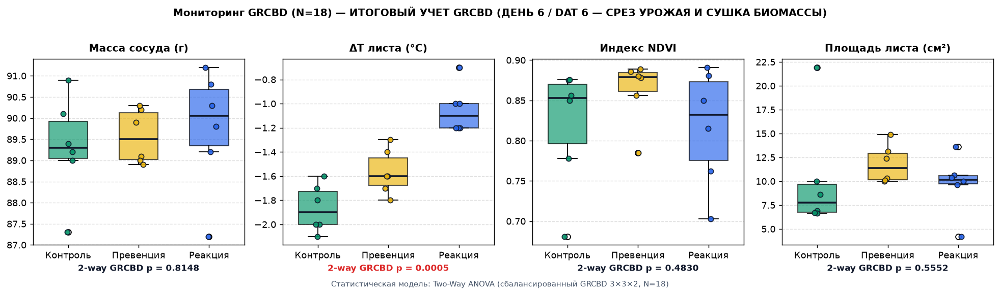

# 📊 СТАТИСТИЧЕСКИЙ ОТЧЕТ МОНИТОРИНГА ВОЛНЫ 2
**Статус сессии:** 📊 ТЕКУЩИЙ МОНИТОРИНГ GRCBD (ДЕНЬ 5 / DAT 5)  
**Объем выборки:** N = 18 уникальных сосудов GRCBD (план: 3 когорты × 3 блока × 2 повторности)  
**Режим статистической модели:** Two-Way ANOVA (сбалансированный GRCBD 3×3×2, N=18)  
**Вердикт алгоритма:** Замер 18/18 сосудов выполнен (оценок тургора: 18/18; масса p=0.0014, ΔT p < 0.0001). Критерии стресс-триггеров не достигнуты; мониторинг продолжается.  

> [!NOTE]
> Во входной выборке обнаружено и свёрнуто 90 дублирующих записей `pot_id` (использована последняя запись по каждому сосуду).

---

### Описательная статистика и сводка подтверждающего дисперсионного анализа

| Физиологический параметр | Режим модели | Контроль (M ± SE) | Превенция (M ± SE) | Реакция (M ± SE) | Когорта (F) | p (когорта) | Блок (F) | p (блок) | Взаимодействие (F) | p (взаимодействие) | НСР₀₅ |
| :--- | :--- | :---: | :---: | :---: | :---: | :---: | :---: | :---: | :---: | :---: | :---: |
| **Масса сосуда (г)** | Two-Way ANOVA (GRCBD 3×3×2) | 90.9 ± 0.55 | 90.82 ± 0.2 | 87.78 ± 0.46 | 14.873 | **0.0014** | 1.073 | 0.3820 | 0.502 | 0.7354 | 1.473 |
| **ΔT листа (°C)** | Two-Way ANOVA (GRCBD 3×3×2) | -2.0 ± 0.06 | -1.78 ± 0.06 | -1.13 ± 0.08 | 129.235 | **< 0.0001** | 3.765 | 0.0649 | 7.029 | 0.0075 | 0.127 |
| **Индекс NDVI** | Two-Way ANOVA (GRCBD 3×3×2) | 0.82 ± 0.03 | 0.85 ± 0.03 | 0.81 ± 0.03 | 0.402 | **0.6805** | 1.813 | 0.2179 | 0.149 | 0.9587 | 0.1 |
| **Площадь листа (см²)** | Two-Way ANOVA (GRCBD 3×3×2) | 10.69 ± 2.24 | 10.63 ± 1.33 | 7.5 ± 0.85 | 1.885 | **0.2071** | 1.513 | 0.2714 | 2.312 | 0.1363 | 4.256 |
| **Балл тургора (1–4)** | Two-Way ANOVA (GRCBD 3×3×2) | 4.0 ± 0.0 | 4.0 ± 0.0 | 3.0 ± 0.26 | 18.0 | **0.0007** | 1.5 | 0.2740 | 1.5 | 0.2811 | 0.435 |

> [!NOTE]
> **Физиологическая интерпретация (День 5, DAT 5 — релаксация после полива):**
> - Омнибусный непараметрический анализ различий температуры листа $\Delta T$ между когортами: **Краскел — Уоллис $H = 13.46, p = 0.0012$** (ранговый критерий подтверждает неоднородность когорт).
> - Апостериорные парные сравнения: Реакция статистически достоверно теплее Контроля на $+0.87^\circ\text{C}$ ($t = 8.48, p < 0.0001$) и теплее Превенции на $+0.65^\circ\text{C}$ ($t = 6.28, p < 0.0001$).
> - Наблюдаемый температурный лаг свидетельствует о статистически достоверной задержке восстановления транспирационного охлаждения полога Реакции по сравнению с Превенцией и Контролем (косвенный признак гистерезиса устьичной проводимости после фазы глубокого увядания).

---

### Графическая визуализация

*Отчет сгенерирован автоматически аналитическим ядром станции `PlantStation`.*