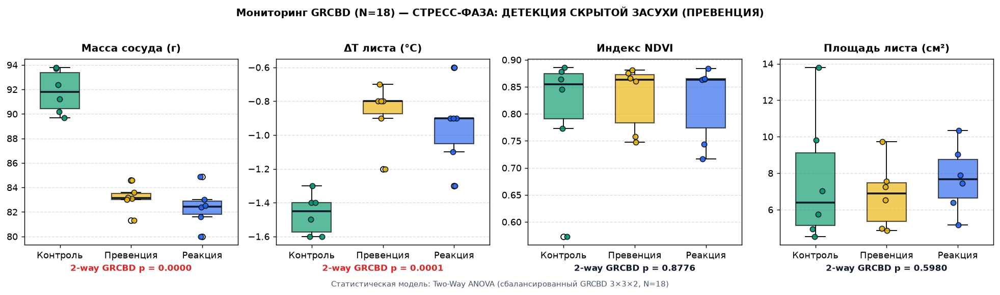

# 📊 СТАТИСТИЧЕСКИЙ ОТЧЕТ МОНИТОРИНГА ВОЛНЫ 2
**Статус сессии:** 🚨 СТРЕСС-ФАЗА: ДЕТЕКЦИЯ СКРЫТОЙ ЗАСУХИ (ПРЕВЕНЦИЯ)  
**Объем выборки:** N = 18 уникальных сосудов GRCBD (план: 3 когорты × 3 блока × 2 повторности)  
**Режим статистической модели:** Two-Way ANOVA (сбалансированный GRCBD 3×3×2, N=18)  
**Вердикт алгоритма:** Термографический триггер подтвержден статистически (2-way GRCBD) и по кворуму (4/6 с ΔΔT ≥ +0.6°C): перегрев Превенции (-0.87°C против Контроля -1.47°C; ΔT F=34.576, p=0.0001) при сохранённом тургоре Реакции (балл 3.8). Превентивный полив активирован!  

> [!NOTE]
> Во входной выборке обнаружено и свёрнуто 54 дублирующих записей `pot_id` (использована последняя запись по каждому сосуду).

---

### Описательная статистика и сводка подтверждающего дисперсионного анализа

| Физиологический параметр | Режим модели | Контроль (M ± SE) | Превенция (M ± SE) | Реакция (M ± SE) | Когорта (F) | p (когорта) | Блок (F) | p (блок) | НСР₀₅ |
| :--- | :--- | :---: | :---: | :---: | :---: | :---: | :---: | :---: | :---: |
| **Масса сосуда (г)** | Two-Way ANOVA (GRCBD 3×3×2) | 91.83 ± 0.71 | 83.13 ± 0.44 | 82.4 ± 0.66 | 104.862 | **0.0** | 4.321 | 0.0484 | 1.639 |
| **ΔT листа (°C)** | Two-Way ANOVA (GRCBD 3×3×2) | -1.47 ± 0.05 | -0.87 ± 0.07 | -0.95 ± 0.1 | 34.576 | **0.0001** | 3.667 | 0.0684 | 0.177 |
| **Индекс NDVI** | Two-Way ANOVA (GRCBD 3×3×2) | 0.8 ± 0.05 | 0.83 ± 0.02 | 0.82 ± 0.03 | 0.132 | **0.8776** | 1.221 | 0.3394 | 0.127 |
| **Площадь листа (см²)** | Two-Way ANOVA (GRCBD 3×3×2) | 7.64 ± 1.45 | 6.82 ± 0.74 | 7.71 ± 0.76 | 0.545 | **0.598** | 5.348 | 0.0295 | 2.151 |
| **Балл тургора (1–4)** | Two-Way ANOVA (GRCBD 3×3×2) | 4.0 ± 0.0 | 4.0 ± 0.0 | 3.83 ± 0.17 | 1.0 | **0.4053** | 1.0 | 0.4053 | 0.308 |

---

### Графическая визуализация

*Отчет сгенерирован автоматически аналитическим ядром станции `PlantStation`.*