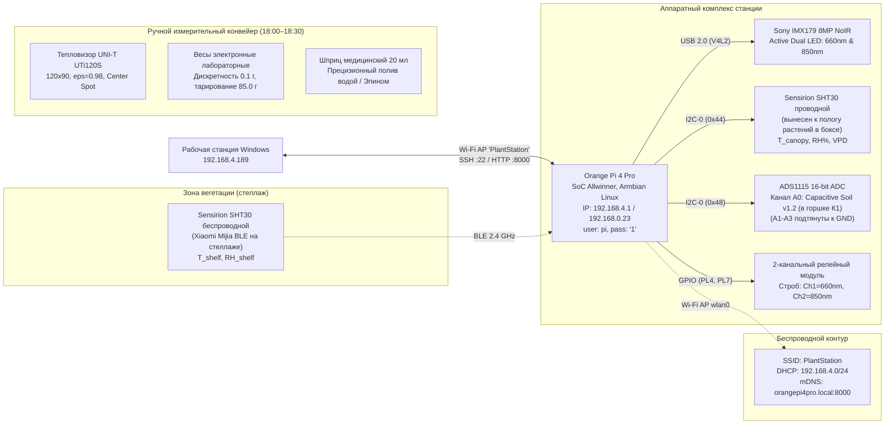

# 🚀 ТЕХНИЧЕСКАЯ ИНСТРУКЦИЯ И ПАСПОРТ ПРОЕКТА (AI-TO-AI HANDOFF)
# ПРОЕКТ: «PLANT-STRESS-NDVI» (ВОЛНА 2: ОГУРЕЦ «КАСКАД»)
## Соответствие регламенту и критериям Всероссийского конкурса научно-технологических проектов «Большие вызовы» (ОЦ «Сириус»)

> **НАЗНАЧЕНИЕ ДОКУМЕНТА:**  
> Исчерпывающий контекстный дамп, архитектурная спецификация и операционный регламент для любой языковой модели (AI-агента), подключающейся к проекту. Содержит актуальные паспортные данные, критерии конкурса «Большие вызовы» (региональный трек Санкт-Петербурга, автор — ученица 10 класса), аппаратный стек, биофизическую методологию Б.А. Доспехова / FAO-56 / CWSI, строгие системные запреты и правила защиты личного вклада автора.

---

## 1. ПАСПОРТ ПРОЕКТА И НАУЧНЫЙ СТАТУС

* **Конкурс:** Всероссийский конкурс научно-технологических проектов «Большие вызовы» (Образовательный центр «Сириус»).
* **Направление конкурса:** «Агропромышленные и биотехнологии».
* **Исследователь (автор):** Ковалёва Алиса Ивановна, учащаяся 10 класса (ГБОУ СОШ №282 Кировского района Санкт-Петербурга).
* **Научно-технический руководитель:** Ковалёв Иван Викторович.
* **Научно-методический консультант:** Профессор кафедры физиологии растений РГАУ-МСХА им. К.А. Тимирязева (методология Б.А. Доспехова, модель Идсо–Джексона CWSI, стандарты FAO-56).
* **Модельный объект:** Огурец посевной (*Cucumis sativus* L.), скороспелый сорт «Каскад».
* **Текущий статус (на 28 октября 2026 г.):** 
  * **25 октября 2026 г.:** Синхронный посев во все 20 сосудов ($M_{\text{база}} = 80.0\ \text{г}$ нетто) + 1 холостой лизиметр $X0$.
  * **28 октября 2026 г.:** Зафиксированы дружные синхронные всходы (100% всхожесть, 20/20 сосудов, семядоли полностью развернуты, гипокотили упругие, балл тургора 1).
  * **Старт стресс-фазы:** Намечен через 3–4 суток (~31 октября — 1 ноября 2026 г.) по достижении фазы полностью развернутого 1-го настоящего листа (диаметр пластинки 4–5 см, корни освоили ризосферу).
* **Культивационные емкости:** 20 индивидуальных вегетационных сосудов $7 \times 7 \times 8\ \text{см}$ ($0.25\ \text{л}$ / 250 мл) с перфорированным дренажным дном + 1 холостой лизиметр ($X0$).
* **Субстратизация:** 60.0 г сухого питательного торфогрунта (40.0 г базовый слой + семя на глубине 1.5 см + 20.0 г покрывной слой) + 20.0 мл отстоянной воды (pH 6.0).
* **Базовая тарированная масса:** строго **$M_{\text{база}} = 80.0\ \text{г}$ (нетто)**.
* **Резюме предыдущего этапа (Волна 1, Горох *Pisum sativum*):** Успешно завершена (11 суток, $N=55$ аппаратурных срезов, $n=45$ растений). Подтверждена анатомическая изоляция корней ячеек (отсутствие трофической конкуренции), верифицирована устьичная окклюзия лаковыми репликами по Молотилову ($85.7\%$ открытых устьиц в контроле против $7.1\%$ при засухе). Превентивный полив обеспечил $+35.8\%$ сырой биомассы (биологический тренд $p=0.20$, побудивший перейти к строгому GRCBD во 2-й волне).

---

## 2. КРИТИЧЕСКИЕ СИСТЕМНЫЕ ОГРАНИЧЕНИЯ (STRICT CONSTRAINTS)

> [!CAUTION]
> **ПРАВИЛО №1: СТРОЖАЙШИЙ ЗАПРЕТ НА КОМАНДЫ GIT!**  
> **КАТЕГОРИЧЕСКИ ЗАПРЕЩЕНО** выполнять `git add`, `git commit`, `git push` без прямого текстового указания пользователя! Пользователь управляет репозиторием и историей версий строго вручную.

> [!CAUTION]
> **ПРАВИЛО №2: НЕПРИКОСНОВЕННОСТЬ АРХИВА СТАНЦИИ 1.0**  
> Файл `/home/pi/plant-stress-ndvi/web_station_v1_backup.py` на микрокомпьютере Orange Pi является неприкосновенным архивным эталоном первой волны. Любая модификация этого файла запрещена.

> [!IMPORTANT]
> **ПРАВИЛО №3: РАБОТА С WINDOWS, СЕТЬЮ И ПУТЯМИ**  
> 1. **Кириллица в Windows:** Метод `cv2.imwrite` в Windows молча падает при наличии кириллицы (`Администратор`). Всегда сохранять и читать изображения через буфер в памяти (`safe_imwrite` / `safe_imread`).
> 2. **Экранирование PowerShell:** Избегать сложных однострочников `python -c "..."` с вложенными кавычками. Создавать временные `.py` скрипты и запускать их.
> 3. **Приоритет SSH-подключения:** Всегда отдавать приоритет прямому IP `192.168.4.1` (интерфейс точки доступа/Ethernet) с `banner_timeout=30`. Домашний IP `192.168.0.23` использовать как резервный.

---

## 3. ТОПОЛОГИЯ ОБОРУДОВАНИЯ И СЕТИ (HARDWARE & IOT)

### Реквизиты доступа и управление станцией:
* **Хост:** `192.168.4.1` (основной) или `192.168.0.23` (локальная сеть)
* **Пользователь / Пароль:** `pi` / `'1'`
* **Рабочая директория:** `/home/pi/plant-stress-ndvi/`
* **Системная служба:** `plant-station.service`
  * Перезапуск: `sudo systemctl restart plant-station.service`
  * Статус: `systemctl status plant-station.service`
  * Логи: `journalctl -u plant-station.service -n 50 --no-pager`
* **Веб-дашборд станции:** `http://192.168.4.1:8000/`

---

## 4. БИОФИЗИЧЕСКИЙ И МЕТОДОЛОГИЧЕСКИЙ СТАНДАРТ (6 ПРАВИЛ ТИМИРЯЗЕВКИ)

### 1. Адаптивная компенсация нарастания сырой биомассы ($M_{\text{цель}}$)
Фиксированная масса 85.0 г приводит к искусственному скрытому водному голоданию по мере разрастания листового аппарата огурца. Начиная с фазы 2 целевая масса вычисляется динамически:
$$M_{\text{цель}}(t) = 85.0 + (\mathrm{PLA} \times 0.06\ \text{г/см}^2)$$
*где $\mathrm{PLA}$ — проективная площадь листьев в $\text{см}^2$, $0.06\ \text{г/см}^2$ — эмпирический коэффициент сырой массы огурца со сформированной корневой системой.*  
Доза полива шприцем: $\text{Доза} = \max(0, M_{\text{цель}}(t) - M_{\text{тек}})$.

### 2. Нормированный температурный триггер ($\Delta\Delta T$) по модели Идсо–Джексона (CWSI)
Абсолютный перепад $\Delta T_i = T_{\text{листа}, i} - T_{\text{canopy}}$ чувствителен к суточным колебаниям $VPD$. Поэтому предиктивный триггер рассчитывается относительно **живого синхронного Контроля**:
$$\Delta\Delta T = \Delta T_i - \overline{\Delta T}_{\text{контроль}} \ge +0.6\,^\circ\text{C}$$
Триггер группы Превенция (П) считается сработавшим, когда $\Delta\Delta T \ge +0.6^\circ\text{C}$ зафиксирован **минимум у 4 из 6 растений**.

### 3. Лизиметрический контроль чистого испарения субстрата по FAO-56 ($X0$)
В фитотрон установлен холостой горшок $X0$ (85.0 г влажного грунта без растения). Ежедневное взвешивание $X0$ фиксирует физическую эвапорацию почвы ($E$). По стандарту FAO-56 суммарная эвапотранспирация ($ET$) разделяется на испарение почвы и чистую устьичную транспирацию растения ($T$):
$$T = ET - E$$

### 4. Статистический дизайн GRCBD по Б.А. Доспехову ($N=18$) + Пилот ($n=2$)
* **Основная матрица ($N=18$):** 3 физических блока (поддона) $\times$ 3 когорты (К, П, Р) $\times$ 2 повторности на блок. Обрабатывается строгим двухфакторным дисперсионным анализом (**Two-Way ANOVA**) с апостериорным тестом Тьюки (Tukey HSD, $p < 0.05$).
* **Автономный поисковый скрининг «Пилот Эпин» ($n=2$, горшки Э1, Э2):** Изолированный лоток. Proof-of-Concept корень-ассоциированного адаптогенного отклика (качественный описательный анализ, исключен из матрицы ANOVA во избежание дебаланса степеней свободы).

### 5. Метрология инфракрасной термографии (Center Spot)
Замер прибором UNI-T UTi120S проводится строго по **центральному курсору (Center Spot)** на межжилковое пространство верхнего сформированного листа под углом $90^\circ$ с расстояния 15–20 см при коэффициенте излучения **$\varepsilon = 0.98$**. Курсоры Min/Max запрещены, чтобы исключить паразитный захват сухих кромок горшка и теплого торфа.

### 6. Корень-ассоциированный адаптогенный прайминг
Препарат «Эпин-Экстра» (24-эпибрассинолид, 2 кап./100 мл) вносится шприцем **строго под корень** в вечер срабатывания триггера группы П. Опрыскивание по листу исключено: микрокапли искажают оптическое отражение NoIR и нарушают излучательную способность эпидермиса ($\varepsilon \neq 0.98$).

---

## 5. МАТЕМАТИЧЕСКИЕ И ПРОГРАММНЫЕ АЛГОРИТМЫ

### Радиометрический NDVI с калибровкой по фторопласту PTFE:
1. **Дифференциальное вычитание темнового фона (Ambient subtraction):**
   $$\mathrm{Red}_{\text{clean}} = \max(0, L_{\text{red}} - L_{\text{amb}}), \quad \mathrm{NIR}_{\text{clean}} = \max(0, L_{\text{nir}} - L_{\text{amb}})$$
2. **Радиометрический баланс по PTFE:**
   $$\mathrm{NDVI} = \frac{k_{\text{bal}} \cdot \mathrm{NIR}_{\text{clean}} - \mathrm{Red}_{\text{clean}}}{k_{\text{bal}} \cdot \mathrm{NIR}_{\text{clean}} + \mathrm{Red}_{\text{clean}} + 10^{-6}}, \quad k_{\text{bal}} = 4.070$$

### Сегментация листа и проективная площадь (PLA):
* **Бинарная маска ткани:** `(ndvi_map > 0.26) & (nir_channel > 7.0 DN)`.
* **Краевой защитный кроп:** 12% по периметру кадра (отсечение стенок бокса).
* **Связанные компоненты:** `cv2.connectedComponentsWithStats` с фильтрацией шумов $< 20\ \text{пикселей}$.
* **Визуализация:** агрономическая палитра RdYlGn (красный $\to$ желтый $\to$ зеленый) на нейтральном темно-фиолетовом фоне `BGR: [35, 15, 30]`.
* **Площадь полога:** $\mathrm{PLA} = N_{\text{leaf\_px}} \times k_{\text{scale}}^2\ (\text{см}^2)$, масштаб калиброван по маркеру ArUco 15 мм (`DICT_4X4_50`).

### Отраслевые агрофизические метрики:
* **Эффективность водопотребления (WUE, Water Use Efficiency):**
  $$WUE = \frac{DW\ (\text{мг})}{\sum V_{\text{полива}}\ (\text{мл})}$$
* **Суммарный температурный индекс стрессо-дней (SDD, Stress Degree Days):**
  $$SDD = \sum_{t=1}^{D} (T_{\text{листа}}(t) - T_{\text{возд}}(t))$$

---

## 6. КРИТЕРИИ И СПЕЦИФИКАЦИЯ КОНКУРСА «БОЛЬШИЕ ВЫЗОВЫ» (СИРИУС)

1. **Проблематика и научная новизна:**
   * Традиционный полив по визуальному пониканию листьев — запоздалая реакция: при потере тургора хлоропласты уже испытывают ультраструктурные повреждения, ведущие к необратимой потере до $30\text{--}40\%$ урожайности.
   * Разработка предиктивного оптико-термального индикатора фиксирует закрытие устьиц на латентной стадии (за 24–48 ч до видимого увядания).
2. **Экономическая эффективность и анализ аналогов:**
   * Коммерческие комплексы (*Arable Mark 3*, $~2500$ USD; метеостанции *Apogee Instruments*; фитотроны) недоступны для селекционеров, фермеров и сити-ферм.
   * Себестоимость нашей разработки: **~14.8 тыс. руб.** при сопоставимой метрологической точности за счет гибридной архитектуры (IoT-станция на Allwinner + ручной тепловизор UTi120S + весы).
3. **Технологический Roadmap (TRL):**
   * **Текущий уровень — TRL 4:** Лабораторный аппаратно-программный комплекс с адресным ручным внесением термограмм и автономным NoIR-анализом.
   * **Перспективный уровень — TRL 5–6:** Установка микроболометрической матрицы MLX90640 ($32 \times 24$, I2C) на одну оптическую ось с камерой Sony IMX179 NoIR с автосовмещением спектральных каналов через матрицу гомографии (Sensor Fusion).

---

## 7. СТРАТЕГИЯ ЗАЩИТЫ ЛИЧНОГО ВКЛАДА АВТОРА И ШПАРГАЛКА (DEFENSE CHEAT SHEET)

### Правила оформления презентации:
* **Никаких мелких QR-кодов на рабочих слайдах!** Это захламляет экран и отвлекает экспертов от 7-минутного доклада.
* На рабочих слайдах размещаются **3–5 секундные зацикленные беззвучные GIF-анимации**:
  * Алиса ставит горшок и нажимает кнопку NoIR-съемки;
  * Алиса наводит тепловизор UTi120S по Center Spot;
  * Алиса выполняет взвешивание и долив воды шприцем;
  * Алиса работает с интерфейсом станции.
* **Один крупный QR-код на финальном слайде («Спасибо за внимание»)** ведет на посадочную страницу репозитория со ссылками на видеоконвейер, код и CSV-логи.

### Шпаргалка для Алисы (Defense Cheat Sheet):
1. **Шина I2C:** «Это двухпроводной интерфейс (линия данных SDA и линия синхронизации SCL). У нас на шине I2C-0 висят два устройства с уникальными аппаратными адресами: `0x44` — датчик температуры/влажности SHT30 у полога, и `0x48` — 16-битный АЦП ADS1115, опрашивающий аналоговый емкостный щуп почвы».
2. **`cv2.connectedComponentsWithStats`:** «Функция OpenCV для поиска связных областей пикселей. Мы используем её для фильтрации: отбрасываем случайные световые шумы площадью менее 20 пикселей и вычисляем суммарную площадь маски листа».
3. **Калибровка $k_{\text{bal}} = 4.070$:** «Кремниевая матрица IMX179 NoIR более чувствительна к красному каналу (660 нм), чем к инфракрасному (850 нм). Чтобы на спектрально-нейтральном белом теле (фторопласт PTFE) индекс $NDVI$ был строго равен нулю, введен балансный множитель $k_{\text{bal}} = 4.070$».
4. **Лаковые реплики Молотилова:** «На нижнюю сторону листа наносится тонкий слой прозрачного лака, после высыхания снимается скотчем и исследуется под микроскопом при $400\times$. Это позволило напрямую сосчитать открытые и закрытые устьичные щели и доказать физиологическое закрытие устьиц при засухе».
5. **Нормированный триггер $\Delta\Delta T$:** «Абсолютная температура листа зависит от батарей отопления и влажности в комнате. Мы вычитаем температуру живого здорового контроля: $\Delta\Delta T = \Delta T_i - \overline{\Delta T}_{\text{контроль}}$. Если $\Delta\Delta T \ge +0.6^\circ\text{C}$ — устьица закрылись именно из-за жажды, а не из-за погоды».

---

## 8. КАРТА ФАЙЛОВ И СИНХРОНИЗАЦИЯ

Все файлы синхронизированы в 5 локациях:
1. `docs/wave2/` (Основной репозиторий)
2. `planned_experiments/wave2_cucumber_study/` (Резервная проектная ветка)
3. `plant-stress-ndvi-audit/docs/wave2/` (Аудиторская копия)
4. `C:\Users\Администратор\Documents\Волна2_Огурец\` (Рабочая пользовательская папка на Windows)
5. `/home/pi/plant-stress-ndvi/` (Удаленная станция Orange Pi 4 Pro)

### Состав ключевых файлов:
* `PROTOCOL_WAVE2_CUCUMBER.md` — Академический мастер-протокол (цель, GRCBD, FAO-56, формулы).
* `LAB_LOG_INSTRUCTIONS.md` — Экспресс-памятка для Алисы на конвейер 18:00–18:30 (с ручной привязкой термограмм).
* `HANDOFF_WAVE2.md` — Данный генеральный документ передачи дел.
* `scripts/run_dospekhov_anova.py` — Автономный модуль Two-Way ANOVA по Доспехову с тестом Тьюки (FW, DW, WC, WUE) и графиками 300 DPI.
* `anova_results/` — Каталог протоколов ANOVA, шаблона среза и графиков Тьюки.
* `aruco_markers/` — Каталог A4 PDF и SVG готовых к печати маркеров и наклеек (DICT_4X4_50).

---

## 9. ПРОВЕРОЧНЫЙ ЧЕК-ЛИСТ (VERIFICATION CHECKLIST)

- [x] Паспорт автора: Алиса Ковалёва, 10 класс (ГБОУ СОШ №282 Кировского района СПб).
- [x] Научный руководитель: Ковалёв Иван Викторович; методконсультант: Профессор РГАУ-МСХА.
- [x] Правило запрета Git принято: ни одной команды git add/commit/push.
- [x] Архив web_station_v1_backup.py защищен от записи.
- [x] Аппаратная платформа: Orange Pi 4 Pro на процессоре Allwinner.
- [x] Формула NDVI нормализована с коэффициентом $k_{\text{bal}} = 4.070$ и вычитанием фона $L_{\text{amb}}$.
- [x] Лизиметрический горшок $X0$ включен в расчет истинной транспирации $T = ET - E$.
- [x] Динамическая компенсация $M_{\text{цель}}(t) = 85.0 + \mathrm{PLA} \times 0.06$ активна.
- [x] Триггер $\Delta\Delta T \ge +0.6^\circ\text{C}$ нормирован по живому среднему группы [К1–К6].
- [x] Внесение «Эпин-Экстра» разрешено строго под корень шприцем (без опрыскивания листьев).
- [x] В веб-интерфейс станции добавлена ручная загрузка термограмм и модальный просмотрщик (Lightbox Viewer).
- [x] Модуль Two-Way ANOVA по Доспехову с тестом Тьюки создан, протестирован и сгенерировал графики 300 DPI.
- [x] Сформулированы критерии «Больших вызовов», экономика (14.8 тыс. руб.) и Defense Cheat Sheet для Алисы.
