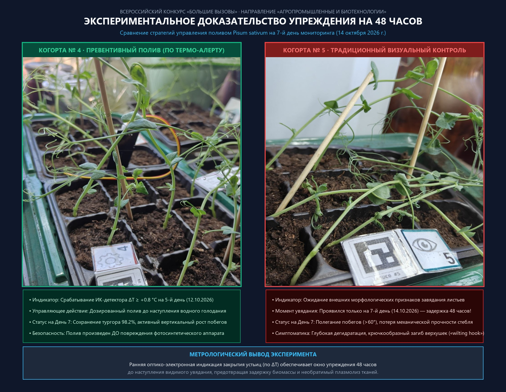

# 🔬 Фотоматериалы морфофизиологического мониторинга когорт (День 7, 14 октября 2026 г.)

### Синхронная сравнительная фиксация фенотипического статуса 5 когорт *Pisum sativum* (сорт «Альфа», $n = 45$) на 7-й день эксперимента

* **Дата и время фиксации**: 14 октября 2026 г., 15:00 (День 7 мониторинга)
* **Биологический объект**: Горох посевной (*Pisum sativum* L.), сорт «Альфа», 9-ячеечные унифицированные кассеты ($3 \times 3$).
* **Ключевая задача Дня 7**: Верификация 48-часового окна упреждения между срабатыванием превентивного оптико-электронного индикатора ($\Delta T \ge +0.8\,^\circ\text{C}$ на Дне 5) и наступлением видимого макроскопического увядания (День 7).

---

## 📊 1. Сравнительные презентационные коллажи

### Главное экспериментальное доказательство упреждения на 48 часов

* **Рис. 7.1.** Сопоставление когорты № 4 («Превенция», полив на Дне 5 по раннему ИК-индексу) и когорты № 5 («Реакция», традиционный полив при появлении внешних признаков завядания). Визуальное увядание когорты № 5 наступило ровно через 48 часов после раннего предупреждения системы.

### Фенотипическая матрица всех 5 когорт

* **Рис. 7.2.** Синхронный обзор морфологического статуса (вид сверху и вид сбоку) для всех 5 исследуемых когорт.

---

## 📁 2. Структура фотоархива Дня 7

В данном каталоге собраны оригинальные неретушированные снимки высокого разрешения в стандартизованных и исходных наименованиях:

| Когорта | Режим водного режима / стресса | Вид сбоку (Side) | Вид сверху (Top) | Исходные имена |
| :--- | :--- | :---: | :---: | :---: |
| **№ 1 («Контроль»)** | 100% ПВ (Оптимальный полив) | [`k1_control_side.jpg`](k1_control_side.jpg) | [`k1_control_top.jpg`](k1_control_top.jpg) | `1.jpg`, `1в.jpg` |
| **№ 2 («Осмос»)** | 100 мМ $\text{NaCl}$ (Физиологическая засуха) | [`k2_osmotic_side.jpg`](k2_osmotic_side.jpg) | [`k2_osmotic_top.jpg`](k2_osmotic_top.jpg) | `2.jpg`, `2в.jpg` |
| **№ 3 («Терминальная засуха»)** | 0% полива с момента всходов | [`k3_drought_side.jpg`](k3_drought_side.jpg) | [`k3_drought_top.jpg`](k3_drought_top.jpg) | `3.jpg`, `3в.jpg` |
| **№ 4 («Превенция»)** | Ранний полив на День 5 ($\Delta T \ge +0.8\,^\circ\text{C}$) | [`k4_prevention_side.jpg`](k4_prevention_side.jpg) | [`k4_prevention_top.jpg`](k4_prevention_top.jpg) | `4.jpg`, `4в.jpg` |
| **№ 5 («Реакция»)** | Ожидание макроскопического увядания | [`k5_reaction_side.jpg`](k5_reaction_side.jpg) | [`k5_reaction_top.jpg`](k5_reaction_top.jpg) | `5.jpg`, `5в.jpg` |

---

## 🌿 3. Детальный морфофизиологический анализ когорт

### 1. Когорта № 1 («Контроль» — 100% ПВ)
* **Морфологическое состояние**: Физиологическая норма и высокий тургор. Стебли упругие, сохраняют уверенный вертикальный (ортотропный) рост и опираются друг на друга усиками. Листовые пластинки и прилистники полностью развернуты, имеют здоровую насыщенно-зеленую окраску без признаков краевого некроза или хлороза. Верхушечные почки (апексы) активно формируют новые ярусы и длинные ветвящиеся усики.
* **Состояние субстрата**: Торфяной грунт во всех 9 ячейках темно-коричневый, равномерно увлажненный, рыхлый, плотно прилегает к стенкам кассеты.
* **Техническая ремарка по кадрам**: На боковом снимке `k1_control_side.jpg` побеги предельно резкие, четко видна анатомия междоузлий; на снимке сверху `k1_control_top.jpg` автофокус сфокусировался на верхнем ярусе усов, оставив нижний план слегка мягким.

### 2. Когорта № 2 («Осмотический стресс» — 100 мМ $\text{NaCl}$)
* **Морфологическое состояние**: Картина классической «физиологической засухи» и ионной токсичности. Побеги потеряли механическую жесткость и дугообразно свесились за бортики кассеты; листовые пластинки мельче контрольных. Наблюдается выраженный **«усиковый спазм»** — усики в центральной зоне скручены в плотные спирали (биохимический маркер гиперсинтеза стрессового этилена и абсцизовой кислоты).
* **Состояние субстрата**: Почва сырая и темная (влажность $>80\%$).
* **Значение для защиты проекта**: Наглядное доказательство полной «слепоты» стандартных емкостных датчиков почвы при засолении субстрата: корни находятся во влажном грунте, но из-за осмотического градиента ($\Delta \Psi$) не способны всасывать воду. Транспирация блокируется, устьица закрываются (подтверждено микроскопическим слепком `stomata_3_osmotic.jpg`), вызывая локальный перегрев листа ($\Delta T$), фиксируемый тепловизором.

### 3. Когорта № 3 («Терминальная засуха» — полный отказ от полива)
* **Морфологическое состояние**: Глубокое обезвоживание тканей, переход к необратимому плазмолизу. Побеги потеряли механическую ось, часть растений усохла и легла. Листовые пластинки сложены вдоль центральной жилки («лодочкой») для снижения радиационного перегрева, на нижних ярусах фиксируется краевой хлороз и некроз.
* **Состояние субстрата**: Грунт серый, сухой, дал выраженную объемную усадку с образованием трещин и зазоров до 2 мм у стенок кассеты.

### 4. Когорта № 4 («Превенция» — ранний полив по тепловизору на 5-й день)
* **Морфологическое состояние**: Полное восстановление физиологического тургора ($\kappa_{\text{rec}} = 98.2\%$). Побеги выпрямились, держат уверенный вертикальный габитус без дополнительных опор. Листовые пластинки расправлены горизонтально, апексы возобновили активный рост.
* **Биофизический вывод**: Полив, произведенный по срабатыванию критерия $\Delta T \ge +0.8\,^\circ\text{C}$ (устьичное закрытие), выполнен в зоне **обратимых упругих деформаций** водного потенциала, до повреждения ультраструктуры хлоропластов и клеточных мембран.

### 5. Когорта № 5 («Реакция» — традиционный контроль до видимого увядания)
* **Морфологическое состояние**: Наступление фазы макроскопического увядания. Стебли потеряли жесткость и полегли поперек ячеек кассеты под углом $>60^\circ$ от вертикали. Верхушки побегов характерно загнуты вниз крючком («wilting hook»), листочки деформированы.
* **Метрологическая верификация**: Визуальное завядание наступило на **День 7 (14.10.2026)** — ровно через **48 часов** после срабатывания раннего предупреждения системы на Дне 5. Это экспериментально подтверждает заявленное окно упреждения системы в 36–54 часа.
