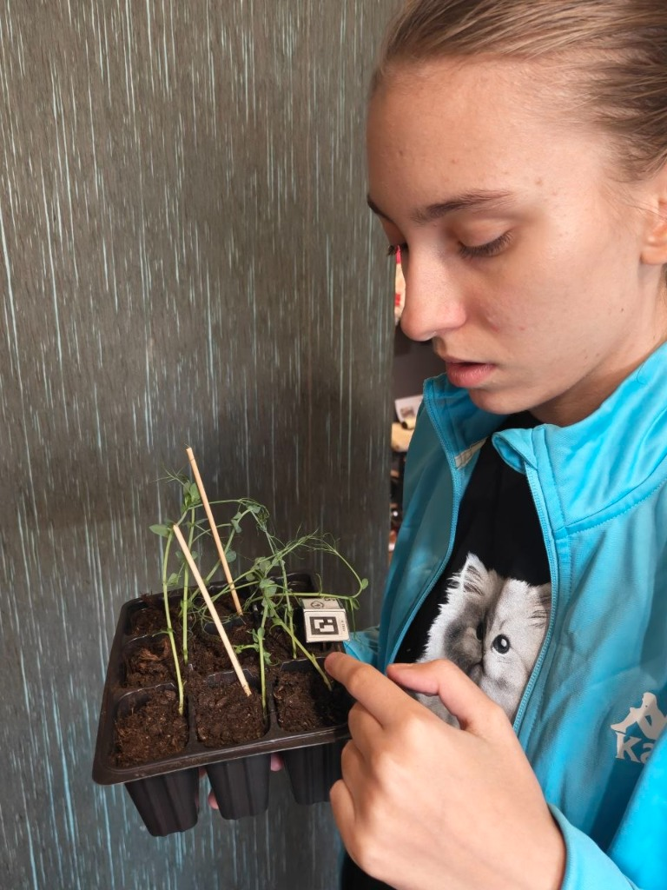
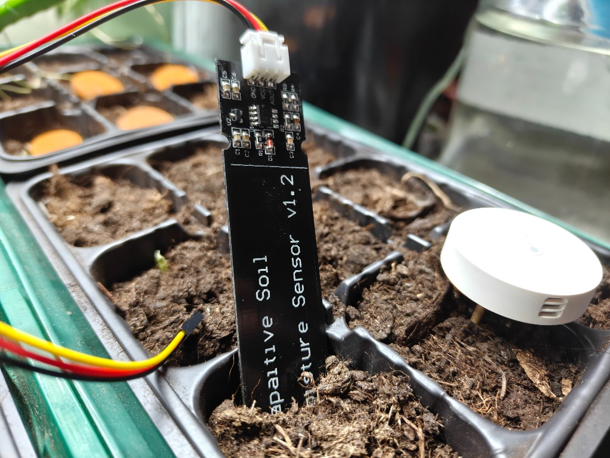
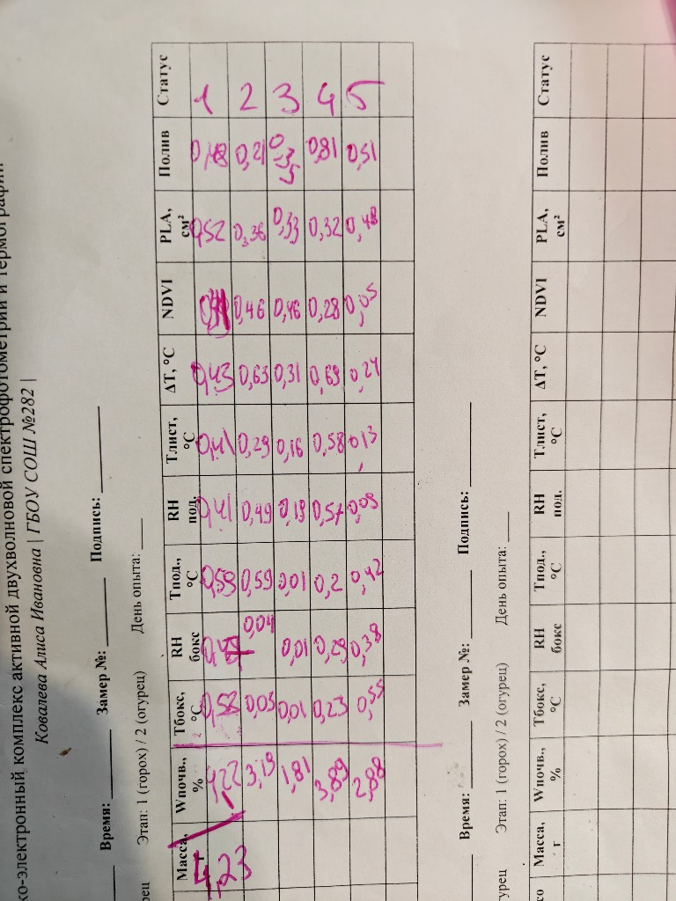
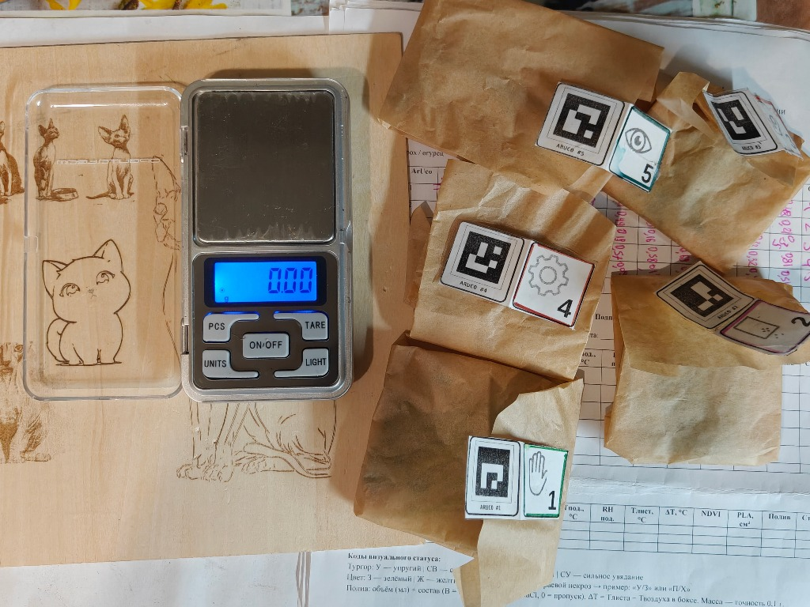
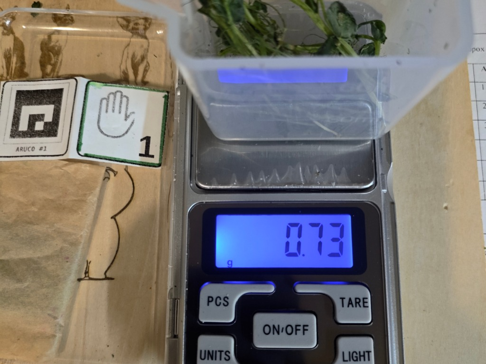
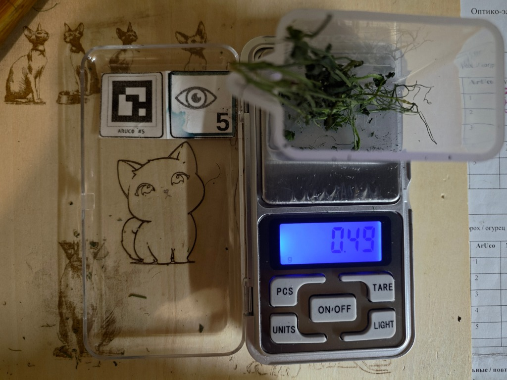
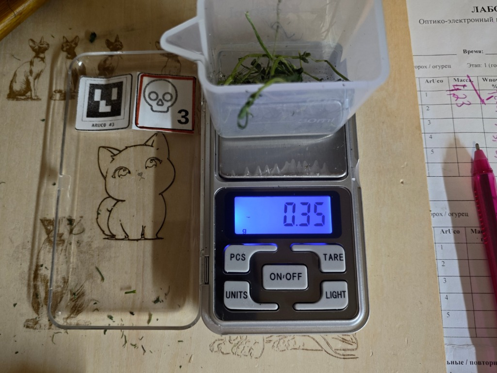

# 🔬 Пилотная серия опытов: Горох (*Pisum sativum*)
### Синхронный мониторинг 5 когорт (8–18 октября 2026 г., 11 дней)

Серия опытов: `exp_1791463544`  
Культура: Горох овощной (*Pisum sativum*), сорт «Альфа», посев 29 сентября 2026 г. ($n = 45$, 9 растений в кассете).  
Аппаратный комплекс: Оптико-электронная станция двухволновой спектрофотометрии (660/850 нм) и термографии UTi120S.

---

## 📋 Сводный журнал физиологических измерений (Дни 1–11)

| № | Дата и время | Когорта | Масса | T возд / RH | T листа | ΔT (Стресс) | NDVI | PLA (см²) | Почва | Тепловизор |
| :-: | :--- | :--- | :-: | :-: | :-: | :-: | :-: | :-: | :-: | :-: |
| **#277** | 18 окт 2026, 18:05 | 🟢 **Контроль (#1)** | **256.6 г** | 23.2°C · 52.1% | **21.3°C** | **-1.9°C (Норма)** | **0.785±0.144** | **18.9 см²** | 78.9% | `therm_277.jpg` |
| **#278** | 18 окт 2026, 18:06 | 🟣 **Осмос (#2)** | **291.4 г** | 23.2°C · 51.9% | **24.5°C** | **+1.3°C (Стресс)** | **0.758±0.174** | **13.2 см²** | 82.1% | `therm_278.jpg` |
| **#279** | 18 окт 2026, 18:07 | 🔴 **Засуха (#3)** | **188.2 г** | 23.2°C · 52.0% | **25.5°C** | **+2.3°C (Стресс)** | **0.648±0.200** | **3.2 см²** | 11.0% | `therm_279.jpg` |
| **#280** | 18 окт 2026, 18:08 | 🟡 **Превенция (#4)** | **271.8 г** | 23.2°C · 51.8% | **22.2°C** | **-1.0°C (Норма)** | **0.816±0.121** | **19.8 см²** | -- | `therm_280.jpg` |
| **#281** | 18 окт 2026, 18:09 | 🔵 **Реакция (#5)** | **263.2 г** | 23.2°C · 52.2% | **22.3°C** | **-0.9°C (Норма)** | **0.761±0.135** | **13.2 см²** | -- | `therm_281.jpg` |
| **#268** | 17 окт 2026, 18:02 | 🟢 **Контроль (#1)** | **254.8 г** | 23.7°C · 48.6% | **22.3°C** | **-1.4°C (Норма)** | **0.808±0.130** | **19.9 см²** | 77.9% | `therm_268.jpg` |
| **#269** | 17 окт 2026, 18:03 | 🟣 **Осмос (#2)** | **290.5 г** | 23.7°C · 48.4% | **24.5°C** | **+0.8°C (Стресс)** | **0.785±0.164** | **15.8 см²** | 81.9% | `therm_269.jpg` |
| **#270** | 17 окт 2026, 18:04 | 🔴 **Засуха (#3)** | **197.3 г** | 23.7°C · 48.5% | **26.0°C** | **+2.3°C (Стресс)** | **0.673±0.190** | **2.4 см²** | 11.3% | `therm_270.jpg` |
| **#271** | 17 окт 2026, 18:05 | 🟡 **Превенция (#4)** | **271.7 г** | 23.7°C · 48.3% | **22.6°C** | **-1.1°C (Норма)** | **0.756±0.172** | **16.4 см²** | -- | `therm_271.jpg` |
| **#272** | 17 окт 2026, 18:06 | 🔵 **Реакция (#5)** | **262.1 г** | 23.7°C · 48.5% | **22.9°C** | **-0.8°C (Норма)** | **0.798±0.141** | **10.9 см²** | -- | `therm_272.jpg` |
| **#251** | 16 окт 2026, 18:06 | 🟢 **Контроль (#1)** | **254.3 г** | 24.9°C · 65.7% | **23.2°C** | **-1.7°C (Норма)** | **0.811±0.129** | **20.9 см²** | 78.9% | `therm_251.jpg` |
| **#252** | 16 окт 2026, 18:06 | 🟣 **Осмос (#2)** | **287.7 г** | 24.9°C · 65.7% | **25.6°C** | **+0.7°C (Стресс)** | **0.820±0.136** | **16.6 см²** | 80.7% | `therm_252.jpg` |
| **#253** | 16 окт 2026, 18:07 | 🔴 **Засуха (#3)** | **204.9 г** | 24.9°C · 65.7% | **27.0°C** | **+2.1°C (Стресс)** | **0.622±0.209** | **7.9 см²** | 12.1% | `therm_253.jpg` |
| **#254** | 16 окт 2026, 18:12 | 🟡 **Превенция (#4)** | **270.2 г** | 24.9°C · 65.7% | **24.1°C** | **-0.8°C (Норма)** | **0.791±0.163** | **16.6 см²** | -- | `therm_254.jpg` |
| **#255** | 16 окт 2026, 18:14 | 🔵 **Реакция (#5)** | **263.0 г** | 24.9°C · 65.7% | **24.5°C** | **-0.4°C (Норма)** | **0.790±0.126** | **14.9 см²** | -- | `therm_255.jpg` |
| **#241** | 15 окт 2026, 18:03 | 🟢 **Контроль (#1)** | **251.3 г** | 23.4°C · 51.2% | **22.3°C** | **-1.1°C (Норма)** | **0.723±0.152** | **14.1 см²** | 80.4% | `therm_241.jpg` |
| **#242** | 15 окт 2026, 18:05 | 🟣 **Осмос (#2)** | **293.2 г** | 23.4°C · 53.2% | **24.3°C** | **+0.9°C (Стресс)** | **0.788±0.117** | **16.3 см²** | 82.4% | `therm_242.jpg` |
| **#243** | 15 окт 2026, 18:05 | 🔴 **Засуха (#3)** | **209.1 г** | 23.4°C · 52.5% | **25.5°C** | **+2.1°C (Стресс)** | **0.747±0.178** | **7.5 см²** | 14.0% | `therm_243.jpg` |
| **#244** | 15 окт 2026, 18:06 | 🟡 **Превенция (#4)** | **267.9 г** | 23.4°C · 51.7% | **22.7°C** | **-0.7°C (Норма)** | **0.818±0.112** | **12.2 см²** | -- | `therm_244.jpg` |
| **#245** | 15 окт 2026, 18:07 | 🔵 **Реакция (#5)** | **264.6 г** | 23.4°C · 50.5% | **23.2°C** | **-0.2°C (Норма)** | **0.787±0.144** | **13.8 см²** | -- | `therm_245.jpg` |
| **#231** | 14 окт 2026, 18:06 | 🟢 **Контроль (#1)** | **251.0 г** | 23.7°C · 50.0% | **22.2°C** | **-1.5°C (Норма)** | **0.715±0.147** | **15.7 см²** | 82.1% | `therm_231.jpg` |
| **#232** | 14 окт 2026, 18:07 | 🟣 **Осмос (#2)** | **290.2 г** | 23.7°C · 48.2% | **24.9°C** | **+1.2°C (Стресс)** | **0.775±0.146** | **16.5 см²** | 81.3% | `therm_232.jpg` |
| **#233** | 14 окт 2026, 18:08 | 🔴 **Засуха (#3)** | **218.3 г** | 23.7°C · 47.5% | **25.4°C** | **+1.7°C (Стресс)** | **0.784±0.176** | **12.1 см²** | 16.6% | `therm_233.jpg` |
| **#234** | 14 окт 2026, 18:09 | 🟡 **Превенция (#4)** | **265.3 г** | 23.7°C · 47.6% | **22.4°C** | **-1.3°C (Репарация/Норма)** | **0.782±0.153** | **12.5 см²** | 64.0% | `therm_234.jpg` |
| **#235** | 14 окт 2026, 18:10 | 🔵 **Реакция (#5)** | **223.1 г** | 23.7°C · 47.5% | **25.5°C** | **+1.8°C (Коллапс)** | **0.718±0.201** | **7.3 см²** | 64.0% | `therm_235.jpg` |
| **#222** | 13 окт 2026, 21:08 | 🟢 **Контроль (#1)** | **252.3 г** | 23.4°C · 48.4% | **21.8°C** | **-1.6°C (Норма)** | **0.754±0.150** | **18.2 см²** | 77.7% | `therm_222.jpg` |
| **#223** | 13 окт 2026, 21:08 | 🟣 **Осмос (#2)** | **287.2 г** | 23.4°C · 48.9% | **23.5°C** | **+0.1°C (Стресс)** | **0.822±0.118** | **14.9 см²** | 81.6% | `therm_223.jpg` |
| **#224** | 13 окт 2026, 21:09 | 🔴 **Засуха (#3)** | **220.2 г** | 23.4°C · 48.6% | **23.7°C** | **+0.3°C (Стресс)** | **0.739±0.173** | **11.3 см²** | 18.4% | `therm_224.jpg` |
| **#225** | 13 окт 2026, 21:09 | 🟡 **Превенция (#4)** | **265.0 г** | 23.4°C · 48.0% | **22.7°C** | **-0.7°C (Репарация)** | **0.778±0.159** | **8.2 см²** | -- | `therm_225.jpg` |
| **#226** | 13 окт 2026, 21:10 | 🔵 **Реакция (#5)** | **228.7 г** | 23.4°C · 48.4% | **23.2°C** | **-0.2°C (Стресс)** | **0.755±0.153** | **6.7 см²** | -- | `therm_226.jpg` |
| **#207** | 12 окт 2026, 20:03 | 🟢 **Контроль (#1)** | **254.7 г** | 23.6°C · 50.8% | **22.1°C** | **-1.5°C (Норма)** | **0.751±0.159** | **15.1 см²** | 82.0% | `therm_207.jpg` |
| **#208** | 12 окт 2026, 20:04 | 🟣 **Осмос (#2)** | **287.2 г** | 23.6°C · 50.8% | **24.6°C** | **+1.0°C (Стресс)** | **0.784±0.146** | **15.1 см²** | 79.0% | `therm_208.jpg` |
| **#209** | 12 окт 2026, 20:05 | 🔴 **Засуха (#3)** | **231.0 г** | 23.6°C · 50.8% | **24.5°C** | **+0.9°C (Сигнал станции / Стресс)** | **0.767±0.158** | **9.7 см²** | 18.3% | `therm_209.jpg` |
| **#210** | 12 окт 2026, 20:06 | 🟡 **Превенция (#4)** | **246.8 г** | 23.6°C · 50.8% | **24.5°C** | **+0.9°C (Алерт/Полив)** | **0.743±0.143** | **5.9 см²** | -- | `therm_210.jpg` |
| **#211** | 12 окт 2026, 20:06 | 🔵 **Реакция (#5)** | **235.3 г** | 23.6°C · 49.9% | **24.6°C** | **+1.0°C (Стресс)** | **0.771±0.140** | **11.9 см²** | -- | `therm_211.jpg` |
| **#188** | 11 окт 2026, 19:08 | 🟢 **Контроль (#1)** | **251.4 г** | 24.1°C · 56.2% | **22.3°C** | **-1.8°C (Норма)** | **0.808±0.144** | **21.2 см²** | 64.0% | `therm_188.jpg` |
| **#189** | 11 окт 2026, 19:09 | 🟣 **Осмос (#2)** | **283.1 г** | 24.1°C · 56.1% | **23.5°C** | **-0.6°C (Норма)** | **0.777±0.148** | **19.4 см²** | 62.8% | `therm_189.jpg` |
| **#190** | 11 окт 2026, 19:10 | 🔴 **Засуха (#3)** | **241.5 г** | 24.1°C · 56.3% | **23.7°C** | **-0.4°C (Норма)** | **0.810±0.147** | **17.2 см²** | 24.0% | `therm_190.jpg` |
| **#191** | 11 окт 2026, 19:11 | 🟡 **Превенция (#4)** | **253.0 г** | 24.1°C · 56.2% | **23.7°C** | **-0.4°C (Норма)** | **0.755±0.159** | **11.1 см²** | -- | `therm_191.jpg` |
| **#192** | 11 окт 2026, 19:11 | 🔵 **Реакция (#5)** | **243.8 г** | 24.1°C · 56.2% | **23.6°C** | **-0.5°C (Норма)** | **0.783±0.129** | **17.8 см²** | -- | `therm_192.jpg` |
| **#181** | 10 окт 2026, 23:01 | 🟢 **Контроль (#1)** | **249.8 г** | 24.2°C · 55.4% | **23.2°C** | **-1.0°C (Норма)** | **0.755±0.079** | **17.8 см²** | 78.0% | `therm_181.jpg` |
| **#182** | 10 окт 2026, 23:03 | 🟣 **Осмос (#2)** | **282.0 г** | 24.2°C · 55.3% | **23.9°C** | **-0.3°C (Норма)** | **0.781±0.075** | **17.9 см²** | 82.0% | `therm_182.jpg` |
| **#183** | 10 окт 2026, 23:04 | 🔴 **Засуха (#3)** | **254.4 г** | 24.3°C · 55.5% | **23.8°C** | **-0.5°C (Норма)** | **0.748±0.086** | **16.1 см²** | 33.0% | `therm_183.jpg` |
| **#184** | 10 окт 2026, 23:05 | 🟡 **Превенция (#4)** | **261.0 г** | 24.2°C · 55.4% | **23.9°C** | **-0.3°C (Норма)** | **0.742±0.115** | **10.8 см²** | -- | `therm_184.jpg` |
| **#185** | 10 окт 2026, 23:06 | 🔵 **Реакция (#5)** | **252.9 г** | 24.2°C · 55.4% | **24.0°C** | **-0.2°C (Норма)** | **0.785±0.065** | **15.7 см²** | -- | `therm_185.jpg` |
| **#179** | 9 окт 2026, 22:22 | 🟢 **Контроль (#1)** | **252.0 г** | 23.9°C · 57.2% | **23.0°C** | **-0.9°C (Норма)** | **0.752±0.047** | **14.8 см²** | 65.1% | `therm_179.jpg` |
| **#175** | 9 окт 2026, 22:16 | 🟣 **Осмос (#2)** | **283.0 г** | 23.9°C · 57.2% | **23.2°C** | **-0.7°C (Норма)** | **0.800±0.095** | **9.0 см²** | 68.0% | `therm_175.jpg` |
| **#176** | 9 окт 2026, 22:18 | 🔴 **Засуха (#3)** | **270.0 г** | 23.9°C · 57.2% | **23.0°C** | **-0.9°C (Норма)** | **0.790±0.061** | **12.3 см²** | 70.0% | `therm_176.jpg` |
| **#177** | 9 окт 2026, 22:20 | 🟡 **Превенция (#4)** | **274.0 г** | 23.9°C · 57.2% | **23.0°C** | **-0.9°C (Норма)** | **0.747±0.081** | **5.6 см²** | -- | `therm_177.jpg` |
| **#178** | 9 окт 2026, 22:22 | 🔵 **Реакция (#5)** | **264.0 г** | 23.9°C · 57.2% | **23.1°C** | **-0.8°C (Норма)** | **0.795±0.066** | **9.8 см²** | -- | `therm_178.jpg` |
| **#171** | 8 окт 2026, 19:25 | 🟢 **Контроль (#1)** | **272.0 г** | 24.9°C · 65.7% | **23.7°C** | **-1.2°C (Норма)** | **0.789±0.091** | **10.0 см²** | 80.7% | `therm_171.jpg` |
| **#167** | 8 окт 2026, 19:10 | 🟣 **Осмос (#2)** | **295.0 г** | 24.9°C · 65.7% | **23.2°C** | **-1.7°C (Норма)** | **0.830±0.054** | **5.6 см²** | 83.3% | `therm_167.jpg` |
| **#168** | 8 окт 2026, 19:14 | 🔴 **Засуха (#3)** | **298.0 г** | 24.9°C · 65.7% | **23.6°C** | **-1.3°C (Норма)** | **0.810±0.063** | **9.3 см²** | 82.0% | `therm_168.jpg` |
| **#169** | 8 окт 2026, 19:16 | 🟡 **Превенция (#4)** | **297.0 г** | 24.9°C · 65.7% | **23.8°C** | **-1.1°C (Норма)** | **0.796±0.137** | **5.2 см²** | -- | `therm_169.jpg` |
| **#170** | 8 окт 2026, 19:20 | 🔵 **Реакция (#5)** | **290.0 г** | 24.9°C · 65.7% | **23.3°C** | **-1.2°C (Норма)** | **0.801±0.086** | **9.6 см²** | -- | `therm_170.jpg` |

> 📌 **Ключевое событие Дня 7 (14 октября 2026 г.) — Наблюдение 48-часового интервала упреждения и макроскопический коллапс когорты Реакции (#5):**
> * **Кассета №5 («Визуальный контроль / Реакция»)**: ровно через **48 часов** после первого инструментального алерта станции на Дне 5 наступило необратимое макроскопическое увядание — побеги полегли поперек ячеек кассеты под углом $>60^\circ$, апексы характерно загнуты вниз («wilting hook»). Температура листа поднялась до **$25.5^\circ\text{C}$** (транспирационный перегрев $\Delta T = +1.8^\circ\text{C}$ при $T_{\text{возд}} = 23.7^\circ\text{C}$), $PLA = 7.3\text{ см}^2$.
> * **Кассета №4 («Превенция»)**: сохраняет **$98полноеполного тургора и активное транспирационное охлаждение: $T_{\text{листа}} = 22.4^\circ\text{C}$ ($\Delta T = -1.3^\circ\text{C}$). Растения уверенно продолжают ортотропный вегетативный рост ($PLA = 12.5\text{ см}^2$, $NDVI = 0.782\pm 0.153$) благодаря своевременному точечному поливу 36 мл на Дне 5.
> * **Кассета №3 («Терминальная засуха»)**: 7-е сутки без полива. Масса снизилась до **$218.3$ г** (суммарная убыль влаги **$79.7$ г**). Влажность субстрата на минимуме $16.6\%$, температура листа $25.4^\circ\text{C}$ ($\Delta T = +1.7^\circ\text{C}$), растения перешли в фазу необратимого плазмолиза.
> * **Кассета №2 («Осмос 100 мМ NaCl»)**: влажность субстрата высокая (**$81.3\%$**, стандартные емкостные датчики почвы показывают мнимое благополучие), однако температура листа составляет **$24.9^\circ\text{C}$** ($\Delta T = +1.2^\circ\text{C}$). Наглядно проиллюстрировано фундаментальное ограничение емкостных датчиков субстрата при засолении в сравнении с оптико-термографическим комплексом.
> * **Кассета №1 («Контроль»)**: масса $251.0$ г, влажность $82.1\%$, активная транспирация удерживает лист на **$1.5^\circ\text{C}$** холоднее воздуха ($T_{\text{листа}} = 22.2^\circ\text{C}$, $\Delta T = -1.5^\circ\text{C}$, $NDVI = 0.715\pm 0.147$, $PLA = 15.7\text{ см}^2$).

> 📌 **Ключевое событие Дня 6 (13 октября 2026 г.) — Подтверждение репарации Превенции и углубление стресса Засухи:**
> * **Кассета №4 («Превенция»)**: масса после вчерашнего дозированного полива (4 мл в лунку / 36 мл на кассету) возросла с $246.8$ г до **$265.0$ г**. Температура листа снизилась до **$22.7^\circ\text{C}$**, восстановив активное транспирационное охлаждение: **$\Delta T = -0.7^\circ\text{C}$** относительно воздуха ($23.4^\circ\text{C}$). Устьица открыты, фотосинтетический аппарат интактен ($NDVI = 0.778\pm 0.159$, $PLA = 8.2\text{ см}^2$). Получена прямая инструментальная иллюстрация эффективности превентивного полива по маркеру $\Delta T$ без снижения $NDVI$!
> * **Кассета №3 («Терминальная засуха»)**: 6-е сутки без полива. Масса снизилась до **$220.2$ г** (суммарная потеря влаги составила **$77.8$ г** от стартовых $298.0$ г!). Влажность почвы стабильно на критическом минимуме $18.4\%$. Листья удерживают $\Delta T = +0.3^\circ\text{C}$ ($T_{\text{листа}} = 23.7^\circ\text{C}$), $NDVI = 0.739\pm 0.173$, $PLA = 11.3\text{ см}^2$. Наблюдается легкое свертывание листовых пластин вдоль центральной жилки. Оставлена без полива (контроль необратимой гибели).
> * **Кассета №5 («Визуальный контроль / Реакция»)**: масса упала до **$228.7$ г** (суммарная потеря влаги **$61.3$ г**). Площадь проекции листьев $PLA$ резко сократилась до **$6.7\text{ см}^2$** из-за начинающейся потери тургора и поникания верхушечных побегов. $T_{\text{листа}} = 23.2^\circ\text{C}$ ($\Delta T = -0.2^\circ\text{C}$), $NDVI = 0.755\pm 0.153$. Оставлена без полива в ожидании полного визуального увядания (традиционный контроль).
> * **Кассета №1 («Контроль»)**: масса $252.3$ г, влажность субстрата $77.7\%$, максимальная транспирация ($\Delta T = -1.6^\circ\text{C}$, $T_{\text{листа}} = 21.8^\circ\text{C}$ при $T_{\text{возд}} = 23.4^\circ\text{C}$), $NDVI = 0.754\pm 0.150$, максимальная вегетативная масса $PLA = 18.2\text{ см}^2$.
> * **Кассета №2 («Осмос 100 мМ NaCl»)**: масса $287.2$ г, влажность субстрата высокая ($81.6\%$), однако температура листа держится выше воздуха ($T_{\text{листа}} = 23.5^\circ\text{C}$, $\Delta T = +0.1^\circ\text{C}$), подтверждая химическую блокаду устьичной проводимости раствором соли. $NDVI = 0.822\pm 0.118$, $PLA = 14.9\text{ см}^2$.

> 📌 **Ключевое событие Дня 5 (12 октября 2026 г.) — Срабатывание алерта и начало дифференцированного полива:**
> * **Кассета №4 («Превенция»)**: по сигналу прибора ($\Delta T = +0.9^\circ\text{C} > +0.8^\circ\text{C}$, доклинический температурный перегрев листьев при закрытии устьиц) **начат превентивный полив**. Объем полива составил **4 мл обычной (отстоянной) воды в каждую лунку** ($4\text{ мл} \times 9\text{ лунок} = 36\text{ мл}$ на кассету). Доза рассчитана строго в соответствии с количеством потерянной влаги от первого дня измерения (масса снизилась с $297.0$ г до $246.8$ г, суммарная убыль влаги составила **$50.2$ г**).
> * **Кассета №3 («Терминальная засуха»)**: температурный градиент составил $\Delta T = +0.9^\circ\text{C}$, влажность почвы упала до критических $18.3\%$, убыль массы от старта составила **$67.0$ г** ($298.0 \to 231.0$ г). **Оставлена БЕЗ полива, несмотря на сигнал прибора** — продолжается контроль динамики отмирания тканей и фиксация точки невозврата.
> * **Кассета №5 («Визуальный контроль / Реакция»)**: температурный градиент $\Delta T = +1.0^\circ\text{C}$, убыль массы **$54.7$ г** ($290.0 \to 235.3$ г). **Оставлена БЕЗ полива, несмотря на сигнал прибора** — согласно протоколу традиционной агростратегии, полив будет произведен только при появлении явного визуального увядания (потери тургора побегов).
> * **Кассета №1 («Контроль»)**: стабильная гидратация, активная транспирация охлаждает лист ниже воздуха ($\Delta T = -1.2^\circ\text{C}$, $T_{\text{листа}} = 22.4^\circ\text{C}$).
> * **Кассета №2 («Осмос 100 мМ NaCl»)**: влажность субстрата высокая ($79.0\%$), однако температура листа поднялась до $24.6^\circ\text{C}$ ($\Delta T = +1.0^\circ\text{C}$), демонстрируя тяжелый осмотический стресс при влажной почве.

> 📌 **Физиологическая динамика на День 4 (11 октября)**: 
> * **Засуха (#3)**: влажность почвы упала до **24.0%**, масса $241.5$ г (суммарная убыль массы от исходной $298  \to  241.5$ г составила **$56.5$ г**!). Листья пока удерживают тургор, разница температур $\Delta T = -0.4^\circ\text{C}$.
> * **Превенция (#4)** и **Реакция (#5)**: емкостные датчики влажности физически отсутствуют (входы АЦП A0–A2 задействованы под когорты #1, #2, #3). Дефицит влаги контролируется гравиметрическим методом (Ground Truth электронные весы): убыль массы составила **44.0 г** и **46.2 г** соответственно.
> * **Контроль (#1)**: устойчивый тургор и транспирационное охлаждение ($\Delta T = -1.8^\circ\text{C}$, $T_{\text{листа}} = 22.3^\circ\text{C}$ при $T_{\text{возд}} = 24.1^\circ\text{C}$).
> * **Осмос (#2)**: масса $283.1$ г, влажность субстрата $62.8\%$, транспирация умеренная ($\Delta T = -0.6^\circ\text{C}$).

---

## 🖼️ Фотогалерея натурных замеров (Сравнение Дней 1–7)

### Когорта №1: Контроль (Оптимальный полив)
| День 1 (8 окт, #171) | День 2 (9 окт, #179) | День 3 (10 окт, #181) | День 4 (11 окт, #188) | День 5 (12 окт, #207) | День 6 (13 окт, #222) | День 7 (14 окт, #231) |
| :---: | :---: | :---: | :---: | :---: | :---: | :---: |
|  |  |  |  |  |  |  |
| `0.789` · 272 г · 10.0 см² | `0.752` · 252 г · 14.8 см² | `0.755` · 249.8 г · 17.8 см² | `0.808` · 251.4 г · 21.2 см² | `0.751` · 254.7 г · 15.1 см² | `0.754` · 252.3 г · 18.2 см² | `0.715` · 251.0 г · 15.7 см² |
|  |  |  |  |  |  |  |
| $T=23.7^\circ\text{C}$ ($\Delta T=-1.2$) | $T=23.0^\circ\text{C}$ ($\Delta T=-0.9$) | $T=23.2^\circ\text{C}$ ($\Delta T=-1.0$) | $T=22.3^\circ\text{C}$ ($\Delta T=-1.8$) | $T=22.1^\circ\text{C}$ ($\Delta T=-1.5$) | $T=21.8^\circ\text{C}$ ($\Delta T=-1.6$) | $T=22.2^\circ\text{C}$ ($\Delta T=-1.5$) |

---

### Когорта №2: Осмос (100 мМ NaCl, отдельный поддон)
| День 1 (8 окт, #167) | День 2 (9 окт, #175) | День 3 (10 окт, #182) | День 4 (11 окт, #189) | День 5 (12 окт, #208) | День 6 (13 окт, #223) | День 7 (14 окт, #232) |
| :---: | :---: | :---: | :---: | :---: | :---: | :---: |
|  |  |  |  |  |  |  |
| `0.830` · 295 г · 5.6 см² | `0.800` · 283 г · 9.0 см² | `0.781` · 282.0 г · 17.9 см² | `0.777` · 283.1 г · 19.4 см² | `0.784` · 287.2 г · 15.1 см² | `0.822` · 287.2 г · 14.9 см² | `0.775` · 290.2 г · 16.5 см² |
|  |  |  |  |  |  |  |
| $T=23.2^\circ\text{C}$ ($\Delta T=-1.7$) | $T=23.2^\circ\text{C}$ ($\Delta T=-0.7$) | $T=23.9^\circ\text{C}$ ($\Delta T=-0.3$) | $T=23.5^\circ\text{C}$ ($\Delta T=-0.6$) | $T=24.6^\circ\text{C}$ ($\Delta T=+1.0$) | $T=23.5^\circ\text{C}$ ($\Delta T=+0.1$) | $T=24.9^\circ\text{C}$ ($\Delta T=+1.2$) |

---

### Когорта №3: Засуха (Водный дефицит)
| День 1 (8 окт, #168) | День 2 (9 окт, #176) | День 3 (10 окт, #183) | День 4 (11 окт, #190) | День 5 (12 окт, #209) | День 6 (13 окт, #224) | День 7 (14 окт, #233) |
| :---: | :---: | :---: | :---: | :---: | :---: | :---: |
|  |  |  |  |  |  |  |
| `0.810` · 298 г · 9.3 см² | `0.790` · 270 г · 12.3 см² | `0.748` · 254.4 г · 16.1 см² | `0.810` · 241.5 г · 17.2 см² | `0.767` · 231.0 г · 9.7 см² | `0.739` · 220.2 г · 11.3 см² | `0.784` · 218.3 г · 12.1 см² |
|  |  |  |  |  |  |  |
| $T=23.6^\circ\text{C}$ ($\Delta T=-1.3$) | $T=23.0^\circ\text{C}$ ($\Delta T=-0.9$) | $T=23.8^\circ\text{C}$ ($\Delta T=-0.5$) | $T=23.7^\circ\text{C}$ ($\Delta T=-0.4$) | $T=24.5^\circ\text{C}$ ($\Delta T=+0.9$) | $T=23.7^\circ\text{C}$ ($\Delta T=+0.3$) | $T=25.4^\circ\text{C}$ ($\Delta T=+1.7$) |

---

### Когорта №4: Превенция (Ранний полив по алерту станции)
| День 1 (8 окт, #169) | День 2 (9 окт, #177) | День 3 (10 окт, #184) | День 4 (11 окт, #191) | День 5 (12 окт, #210) | День 6 (13 окт, #225) | День 7 (14 окт, #234) |
| :---: | :---: | :---: | :---: | :---: | :---: | :---: |
|  |  |  |  |  |  |  |
| `0.796` · 297 г · 5.2 см² | `0.747` · 274 г · 5.6 см² | `0.742` · 261.0 г · 10.8 см² | `0.755` · 253.0 г · 11.1 см² | `0.743` · 246.8 г · 5.9 см² | `0.778` · 265.0 г · 8.2 см² | `0.782` · 265.3 г · 12.5 см² |
|  |  |  |  |  |  |  |
| $T=23.8^\circ\text{C}$ ($\Delta T=-1.1$) | $T=23.0^\circ\text{C}$ ($\Delta T=-0.9$) | $T=23.9^\circ\text{C}$ ($\Delta T=-0.3$) | $T=23.7^\circ\text{C}$ ($\Delta T=-0.4$) | $T=24.5^\circ\text{C}$ ($\Delta T=+0.9$) | $T=22.7^\circ\text{C}$ ($\Delta T=-0.7$) | $T=22.4^\circ\text{C}$ ($\Delta T=-1.3$) |

---

### Когорта №5: Реакция (Полив по визуальному увяданию)
| День 1 (8 окт, #170) | День 2 (9 окт, #178) | День 3 (10 окт, #185) | День 4 (11 окт, #192) | День 5 (12 окт, #211) | День 6 (13 окт, #226) | День 7 (14 окт, #235) |
| :---: | :---: | :---: | :---: | :---: | :---: | :---: |
|  |  |  |  |  |  |  |
| `0.801` · 290 г · 9.6 см² | `0.795` · 264 г · 9.8 см² | `0.785` · 252.9 г · 15.7 см² | `0.783` · 243.8 г · 17.8 см² | `0.771` · 235.3 г · 11.9 см² | `0.755` · 228.7 г · 6.7 см² | `0.718` · 223.1 г · 7.3 см² |
|  |  |  |  |  |  |  |
| $T=23.3^\circ\text{C}$ ($\Delta T=-1.2$) | $T=23.1^\circ\text{C}$ ($\Delta T=-0.8$) | $T=24.0^\circ\text{C}$ ($\Delta T=-0.2$) | $T=23.6^\circ\text{C}$ ($\Delta T=-0.5$) | $T=24.6^\circ\text{C}$ ($\Delta T=+1.0$) | $T=23.2^\circ\text{C}$ ($\Delta T=-0.2$) | $T=25.5^\circ\text{C}$ ($\Delta T=+1.8$) |

---

## 📸 Морфофизиологический фотомониторинг когорт (День 7, 14 октября 2026 г.)

Синхронная сравнительная фиксация фенотипического статуса всех 5 когорт *Pisum sativum* на 7-й день эксперимента (подтверждение 48-часового окна упреждения):

### Сравнительный коллаж: Превенция (#4) vs Реакция (#5)

*Слева — Кассета №4 («Превенция»): сохранение полного тургора листовых пластинок, вертикальный вегетативный рост благодаря своевременному поливу 36 мл на Дне 5 по сигналу станции. Справа — Кассета №5 («Реакция»): массовое поникание верхушечных побегов (>60°), потеря тургора («wilting hook») через 48 часов после сигнала.*

### Матрица состояния всех 5 когорт на Дне 7 (15:00)

### Детальная фотофиксация потери тургора в когорте №5 («Реакция»)

*Фиксация макроскопического коллапса в 15:00–18:00: побеги полегли на края кассеты, листовые пластинки истончены и подвяли. Согласно протоколу исследования, в 18:00 начат реанимационный полив в объеме потерянной влаги (6 мл на лунку / 54 мл на кассету).*

---

## 📸 Синхронная оптическая и тепловизионная фиксация (День 8, 15 октября 2026 г.)

Каталог оригиналов: [day08_20261015/](day08_20261015/)

Синхронная 8-суточная инструментальная фиксация после реанимационного полива когорты Реакции:
* **Кассета №4 («Превенция»)**: удерживает высокую транспирацию ($T_{\text{листа}} = 22.7^\circ\text{C}$, $\Delta T = -0.7^\circ\text{C}$, $NDVI = 0.818\pm 0.112$, масса $267.9$ г).
* **Кассета №5 («Реакция»)**: после полива на 7-й день масса возросла до $264.6$ г, температура нормализовалась ($\Delta T = -0.2^\circ\text{C}$), однако фиксируются необратимые изгибы стеблей в местах перегиба («kink artifacts»).
* **Кассета №3 («Засуха»)**: углубление термического перегрева ($\Delta T = +2.1^\circ\text{C}$, $T_{\text{листа}} = 25.5^\circ\text{C}$ при влажности субстрата $14.0\%$).

---

## 📸 Натурная гравиметрия и фенотипический статус когорт (День 9, 16 октября 2026 г.)

Каталог оригиналов: [`day09_20261016/`](day09_20261016/)

Прямой инструментальный весовой контроль модельных кассет *Pisum sativum* на электронных весах (дискретность 0.1 г):

| Когорта | Масса кассеты | Динамика водного баланса (от 298.0 г) | Морфологический статус |
| :--- | :---: | :---: | :--- |
| **К1: Контроль** | **254.3 г** | Оптимальная гидратация, влажность 78.9% | Прямостоячий ортотропный габитус, развитый усиковый аппарат |
| **К2: Осмос (100 мМ NaCl)** | **287.7 г** | Субстрат влажный (80.7%), химический блок | Осмотический стресс, спазм усиков, карликовость междоузлий |
| **К3: Засуха** | **204.9 г** | Критический дефицит: убыль **93.1 г** влаги | Полегание побегов, глубокий плазмолиз, закрытие устьиц |
| **К4: Превенция** | **270.2 г** | Стабилизация водного статуса после полива на Д5 | Полное сохранение тургора, активный рост ($PLA = 16.6\text{ см}^2$) |
| **К5: Реакция** | **263.0 г** | Частичное восстановление после полива на Д7 | Стабилизация гидратации, пластические искривления побегов |

---

## 📸 Морфометрическая фиксация исхода стрессовых режимов (День 10, 17 октября 2026 г.)

Каталог оригиналов: [`day10_20261017/`](day10_20261017/)

Синхронная 10-суточная фотофиксация морфологического состояния всех 5 когорт (*Pisum sativum*, $n=45$):

* **Когорта №3 («Терминальная засуха»)**: отрицательный контроль летального обезвоживания. Тотальная дегидратация биомассы до воздушно-сухого состояния, закономерная гибель тканей.
* **Когорта №4 («Упреждающий полив»)**: полив по доклиническому температурному сигналу станции ($\Delta T \ge +0.8^\circ\text{C}$, День 5) обеспечил сохранение ортотропного габитуса, тургора и продуктивности.
* **Когорта №5 («Поздняя реакция»)**: полив после визуального увядания (День 7) восстановил оводненность части тканей, однако привел к деформации проводящих пучков и задержке онтогенеза.
* **Когорта №1 («Контроль»)**: стабильный вегетативный оптимум при 100% ПВ.
* **Когорта №2 («Осмотический стресс»)**: торможение линейного роста и деформация верхушек при высокой влажности субстрата.

---

## 🔬 Финальный деструктивный сбор биомассы, верификация корневой изоляции и поклеточная биометрия (День 11, 18 октября 2026 г.)

Каталог фотодокументации сбора: [day11_20261018/](day11_20261018/)  
Структурированный датасет поклеточных измерений: [data/harvest_biomass_day11.csv](../../data/harvest_biomass_day11.csv)

18 октября 2026 г. по завершении 11-суточного цикла in vivo мониторинга проведена финальная деструктивная уборка урожая (*Destructive Harvest Protocol*) для получения абсолютного физиологического эталона (*Ground Truth*).

### 1. Верификация отсутствия корневой конкуренции (изоляция ячеек C1–C9)

*Препарирование ячеек кассеты и вид после деструктивной срезки: корневая система каждого растения строго изолирована в объеме персональной ячейки C1–C9, корневые переплетения между соседними делянками отсутствуют (исключение трофической конкуренции; кассетный фактор $N=1$, субвыборка по Hurlbert, 1984). Зафиксировано рабочее погружение емкостного датчика влажности почвы Capacitive Soil Moisture Sensor v1.2 и климатического зонда.*

### 2. Поячеечный протокол взвешивания свежей надземной биомассы ($FW$)

Взвешивание каждого растения индивидуально на аналитических весах (дискретность 0.01 г):

| Ячейка кассеты | К1: Контроль | К2: Осмос (100 мМ NaCl) | К3: Засуха (Терминальная) | К4: Превенция (Упреждающий полив) | К5: Реакция (Полив по увяданию) |
| :-: | :-: | :-: | :-: | :-: | :-: |
| **C1** | 0.50 г | 0.63 г | 0.35 г | **0.76 г (краевая)** | 0.55 г |
| **C2** | 0.44 г | 0.35 г | 0.36 г | 0.33 г | 0.27 г |
| **C3** | 0.41 г | 0.39 г | 0.38 г | 0.24 г | 0.32 г |
| **C4** | 0.59 г | 0.44 г | 0.44 г | **0.69 г (краевая)** | 0.47 г |
| **C5** | 0.42 г | 0.35 г | 0.24 г | 0.38 г | 0.48 г |
| **C6** | 0.45 г | 0.30 г | 0.03 г | 0.38 г | 0.24 г |
| **C7** | 0.49 г | 0.41 г | 0.01 г *(некроз)* | 0.58 г | 0.27 г |
| **C8** | 0.49 г | 0.25 г | 0.01 г *(некроз)* | 0.31 г | 0.20 г |
| **C9** | 0.46 г | 0.03 г | 0.01 г *(некроз)* | 0.20 г | 0.05 г |
| **СУММА ($\Sigma FW$)** | **4.25 г** | **3.15 г** | **1.83 г** | **3.87 г** | **2.85 г** |
| **Среднее $\pm$ SD** | $0.472 \pm 0.055$ г | $0.350 \pm 0.160$ г | $0.203 \pm 0.183$ г | $0.430 \pm 0.208$ г | $0.317 \pm 0.160$ г |

### 2.1. Фотофиксация контрольных взвешиваний побегов на аналитических весах (0.01 г)
Метрологический контроль на поверенных цифровых весах в тарированной лодочке с маркировкой ArUco-когорт:

| Тарировка и конверты когорт | К1: Контроль ($0.73\text{ г}$) | К4: Превенция ($0.65\text{ г}$) |
| :---: | :---: | :---: |
|  |  |  |
| **Ноль весов ($0.00\text{ г}$)**, бланк протокола и пакеты когорт с ArUco. | **К1 (Контроль, ArUco #1, ✋): $0.73\text{ г}$**, максимальный тургор полога. | **К4 (Превенция, ArUco #4, ⚙): $0.65\text{ г}$**, сохранение продуктивности. |

| К2: Осмос ($0.55\text{ г}$) | К5: Реакция ($0.49\text{ г}$) | К3: Засуха ($0.35\text{ г}$) |
| :---: | :---: | :---: |
|  |  |  |
| **К2 (Осмос 100 мМ NaCl, ArUco #2): $0.55\text{ г}$**, солевой блок роста. | **К5 (Реакция, ArUco #5, 👁): $0.49\text{ г}$**, потеря $32.7\%$ массы от К4. | **К3 (Засуха, ArUco #3, ☠): $0.35\text{ г}$**, глубокая дегидратация. |

*Данные сведены в таблицу [`data/harvest_validation_scales_day11.csv`](../../data/harvest_validation_scales_day11.csv).*

### 3. Биологические и агрономические выводы:
1. **Превосходство превентивного полива (+35.8% сырой биомассы):**
   Когорта превенции К4 накопила **$3.87$ г** биомассы против **$2.85$ г** в когорте запоздалой реакции К5 ($+35.8\%$, биологический тренд $p = 0.20$; предотвращение гибели относительно засухи К3 достоверно при $p = 0.024$). Своевременный полив по тепловизионному алерту $\Delta T$ до наступления увядания предотвратил кавитацию ксилемы и необратимое повреждение фотосинтетических мембран.
2. **Краевой эффект и вариабельность когорты К4:**
   Растения ячеек **C1 (0.76 г)** и **C4 (0.69 г)** на левом фланге кассеты получили преимущество по освещенности и локальному стоку влаги при шприцевом поливе ($CV = 46.3\%$). При этом средняя биомасса К4 ($0.430$ г) не превысила контроль К1 ($0.472$ г), а ячейки C3 ($0.24$ г) и C9 ($0.20$ г) на противоположном краю отстали в росте. Это иллюстрирует естественный краевой эффект кассетного выращивания, а не гормезис.
3. **Летальный исход терминальной засухи:**
   В когорте К3 суммарная биомасса составила всего $1.83$ г, при этом периферийные растения (ячейки C7, C8, C9) полностью погибли (масса $0.01$ г, сухие некротизированные остатки).
4. **Текущий статус сухой биомассы ($DW$):**
   Все образцы когорт К1–К5 разложены на стандартизованной пергаментной бумаге (пергаментная бумага.jpg) для воздушной сушки до достижения постоянной воздушно-сухой массы с последующим финальным вычислением процента сухого вещества ($DW/FW$) и эффективности использования воды ($WUE$).
